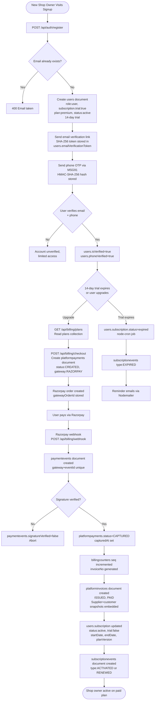
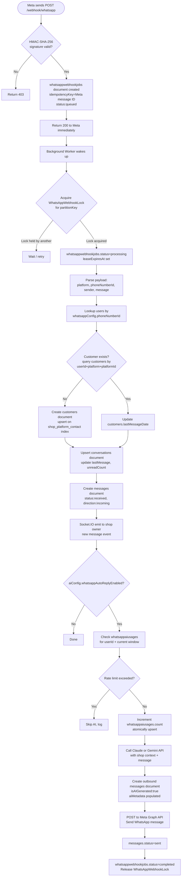
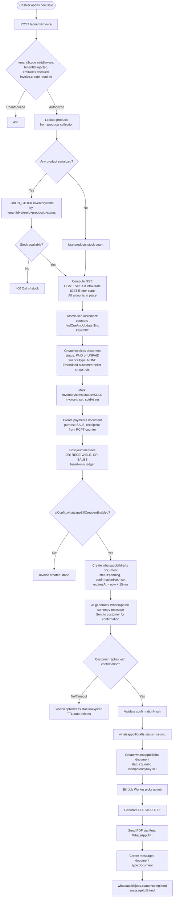
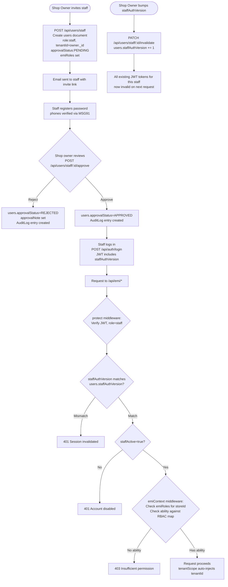
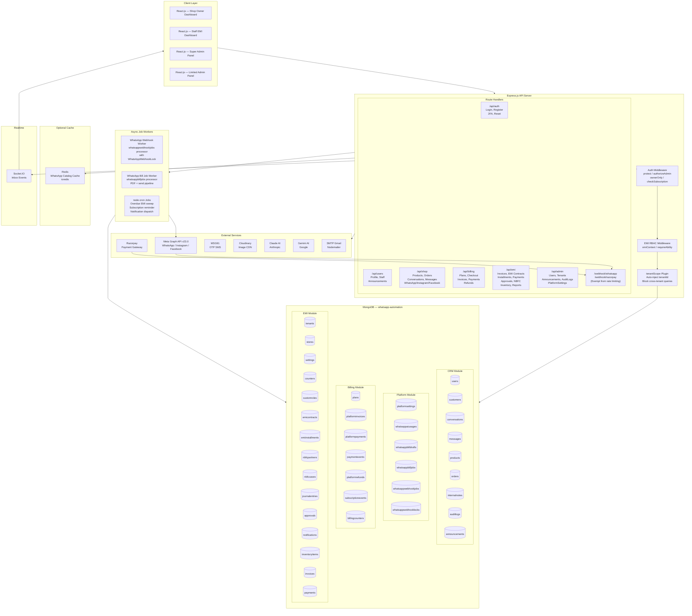

# ChatShop AI – Complete Database Architecture & Audit Documentation

> **Subtitle:** MongoDB Schema Reference, ER Diagrams, Index Strategy, RBAC Matrix & System Flow Documentation  
> **Date:** 2026-11-20  
> **Version:** 1.0  
> **Prepared by:** Senior Database Architect (source-code audit)  
> **Database Engine:** MongoDB (Mongoose ODM)  
> **Default Database Name:** `whatsapp-automation`

---

## Table of Contents

1. [Part 0 – Inspection Scope & Limitations](#part-0--inspection-scope--limitations)
2. [Part 1 – Project Overview](#part-1--project-overview)
3. [Part 2 – MongoDB Collections & Schema Documentation](#part-2--mongodb-collections--schema-documentation)
   - [Collection 1: `users`](#1-users)
   - [Collection 2: `customers`](#2-customers)
   - [Collection 3: `conversations`](#3-conversations)
   - [Collection 4: `messages`](#4-messages)
   - [Collection 5: `products`](#5-products)
   - [Collection 6: `orders`](#6-orders)
   - [Collection 7: `auditlogs`](#7-auditlogs)
   - [Collection 8: `announcements`](#8-announcements)
   - [Collection 9: `internalnotes`](#9-internalnotes)
   - [Collection 10: `platformsettings`](#10-platformsettings)
   - [Collection 11: `whatsappaiusages`](#11-whatsappaiusages)
   - [Collection 12: `whatsappbilldrafts`](#12-whatsappbilldrafts)
   - [Collection 13: `whatsappbilljobs`](#13-whatsappbilljobs)
   - [Collection 14: `whatsappwebhookjobs`](#14-whatsappwebhookjobs)
   - [Collection 15: `whatsappwebhooklocks`](#15-whatsappwebhooklocks)
   - [Collection 16: `plans`](#16-plans)
   - [Collection 17: `platforminvoices`](#17-platforminvoices)
   - [Collection 18: `platformpayments`](#18-platformpayments)
   - [Collection 19: `paymentevents`](#19-paymentevents)
   - [Collection 20: `platformrefunds`](#20-platformrefunds)
   - [Collection 21: `subscriptionevents`](#21-subscriptionevents)
   - [Collection 22: `billingcounters`](#22-billingcounters)
   - [Collection 23: `tenants`](#23-tenants)
   - [Collection 24: `stores`](#24-stores)
   - [Collection 25: `settings`](#25-settings)
   - [Collection 26: `counters`](#26-counters)
   - [Collection 27: `customroles`](#27-customroles)
   - [Collection 28: `emicontracts`](#28-emicontracts)
   - [Collection 29: `emiinstallments`](#29-emiinstallments)
   - [Collection 30: `nbfcpartners`](#30-nbfcpartners)
   - [Collection 31: `nbfccases`](#31-nbfccases)
   - [Collection 32: `journalentries`](#32-journalentries)
   - [Collection 33: `approvals`](#33-approvals)
   - [Collection 34: `notifications`](#34-notifications)
   - [Collection 35: `inventoryitems`](#35-inventoryitems)
   - [Collection 36: `invoices`](#36-invoices)
   - [Collection 37: `payments`](#37-payments)
4. [Part 3 – Complete ER Diagram](#part-3--complete-er-diagram)
5. [Part 4 – Complete Index Strategy](#part-4--complete-index-strategy)
6. [Part 5 – Role-Based Access Control Matrix](#part-5--role-based-access-control-matrix)
   - [5A – Platform-Level Roles](#5a--platform-level-roles)
   - [5B – EMI Module Roles](#5b--emi-module-roles)
   - [5C – Collection-Level Access Matrix](#5c--collection-level-access-matrix)
   - [5D – Security Rules](#5d--security-rules-verified-from-code)
7. [Part 6 – System Flowcharts](#part-6--system-flowcharts)
   - [6A – User Registration & Subscription Flow](#6a--user-registration--subscription-flow)
   - [6B – WhatsApp Webhook Ingestion Flow](#6b--whatsapp-webhook-ingestion-flow)
   - [6C – Counter Sale (Store Invoice) Flow](#6c--counter-sale-store-invoice-flow)
   - [6D – Shop EMI Contract Flow](#6d--shop-emi-contract-flow)
   - [6E – Admin & Super Admin Workflow](#6e--admin--super-admin-workflow)
   - [6F – Staff Invitation & Approval Flow](#6f--staff-invitation--approval-flow)
8. [Part 7 – Complete System Architecture Diagram](#part-7--complete-system-architecture-diagram)
9. [Part 8 – External Integrations Reference](#part-8--external-integrations-reference)
10. [Part 9 – Data Integrity & Consistency Mechanisms](#part-9--data-integrity--consistency-mechanisms)
11. [Part 10 – Operational Notes & Maintenance Guidance](#part-10--operational-notes--maintenance-guidance)

---

## Part 0 – Inspection Scope & Limitations

### What Was Inspected

This document was produced through a **static source-code audit** only. The following artifacts were read and analysed:

| Artifact | Description |
|----------|-------------|
| `src/models/User.model.js` | Core user, subscription, platform config schema |
| `src/models/Customer.model.js` | Customer/contact schema |
| `src/models/Conversation.model.js` | Conversation thread schema |
| `src/models/Message.model.js` | Message payload schema |
| `src/models/Product.model.js` | Shop product catalogue schema |
| `src/models/Order.model.js` | CRM order schema |
| `src/models/AuditLog.model.js` | Platform audit log schema |
| `src/models/Announcement.model.js` | Admin announcement schema |
| `src/models/InternalNote.model.js` | Customer internal note schema |
| `src/models/PlatformSettings.model.js` | Singleton platform settings schema |
| `src/models/WhatsAppAIUsage.model.js` | AI rate-limit tracking schema |
| `src/models/WhatsAppBillDraft.model.js` | WhatsApp bill draft schema |
| `src/models/WhatsAppBillJob.model.js` | WhatsApp bill delivery job schema |
| `src/models/WhatsAppWebhookJob.model.js` | Webhook durable queue schema |
| `src/models/WhatsAppWebhookLock.model.js` | Distributed lock schema |
| `src/billing/models.js` | Plans, PlatformInvoices, PlatformPayments, PaymentEvents, PlatformRefunds, SubscriptionEvents, BillingCounters |
| `src/emi/models/platform.js` | Tenants, Stores, Settings, Counters, CustomRoles |
| `src/emi/models/finance.js` | EmiContracts, EmiInstallments, NbfcPartners, NbfcCases, JournalEntries, Approvals, Notifications |
| `src/emi/models/sales.js` | InventoryItems, Invoices, Payments |
| `src/emi/middleware/rbac.js` | EMI RBAC permission map |
| `env.example` | Environment variable reference |
| `package.json` | Dependency list |

### What Was NOT Inspected

> [!IMPORTANT]
> **No direct connection to any live MongoDB instance was established during this audit.** The following were not examined:
>
> - Live collection documents or actual data volumes
> - Current index usage statistics (`$indexStats`)
> - Query profiler output
> - Actual TTL background job activity
> - Replica set or sharding configuration (if any)
> - MongoDB Atlas configuration, network peering, or backup policies
> - Any runtime-created collections not backed by a Mongoose model

### Zero-Modification Confirmation

> [!CAUTION]
> This is a **documentation-only deliverable**. Zero source code files, model files, database configuration files, migration scripts, seed files, or environment files were modified, created, or deleted as part of producing this document.

### Collection Name Inference

Mongoose follows the convention of **lowercasing and pluralising** the model name to derive the MongoDB collection name. For example:

| Mongoose Model Name | Inferred Collection Name |
|--------------------|--------------------------|
| `User` | `users` |
| `WhatsAppWebhookJob` | `whatsappwebhookjobs` |
| `EmiContract` | `emicontracts` |
| `NbfcPartner` | `nbfcpartners` |
| `JournalEntry` | `journalentries` |

Where Mongoose's default pluralisation differs from an explicit `collection:` option in the schema, the explicit name takes precedence. All 37 collection names listed in this document are inferred from verified Mongoose model registrations.

---

## Part 1 – Project Overview

### Application Identity

| Property | Value |
|----------|-------|
| **Product Name** | ChatShop AI |
| **Type** | Multi-channel Business Automation CRM + EMI & Billing SaaS |
| **Purpose** | Enables retail businesses to sell, invoice, collect EMI payments, and communicate with customers through WhatsApp, Instagram, and Facebook — all from a single unified platform |
| **Database** | MongoDB (default DB name: `whatsapp-automation`) |
| **ODM** | Mongoose |

### Technology Stack

| Layer | Technology |
|-------|-----------|
| **Backend Runtime** | Node.js |
| **API Framework** | Express.js |
| **Database** | MongoDB via Mongoose ODM |
| **Frontend** | React.js |
| **Realtime** | Socket.IO |
| **Image Storage** | Cloudinary (CDN) |
| **Payment Gateway** | Razorpay |
| **OTP / SMS** | MSG91 |
| **Email** | Nodemailer + SMTP (Gmail) |
| **Cache (optional)** | Redis (ioredis) |
| **AI Assistant** | Claude (Anthropic) + Gemini (Google) |
| **PDF Generation** | PDFKit |
| **QR Codes** | QRCode library |
| **Scheduled Jobs** | node-cron |
| **Security Headers** | Helmet |

### System Principals

The platform defines **four distinct types of principals**:

| Principal | Storage | `role` Value | Description |
|-----------|---------|-------------|-------------|
| **Shop Owner** | `users` collection | `"user"` | Registers a shop, connects WhatsApp/Instagram/Facebook, manages products, orders, staff, and EMI contracts. Each shop owner is one tenant. |
| **Platform Admin** | `users` collection | `"admin"` | Operates the ChatShop AI platform itself. Has one of two admin levels (see below). |
| **Staff** | `users` collection | `"staff"` | Employee of a shop owner. Can only access EMI routes. Scoped by `tenantId` and `emiRoles`. |
| **End Customer** | `customers` collection | *(not in users)* | Consumer contacting the shop via WhatsApp, Instagram, or Facebook. Stored as a `Customer` document, **not** as a `User`. |

### Admin Levels

| `adminLevel` | Label | Scope |
|-------------|-------|-------|
| `"super"` | **Super Admin** | Full platform access — all tenants, all collections, platform settings, plan management, announcements. Can "open as shop" (impersonate any shop owner via `actingAdmin` JWT claim). |
| `"admin"` | **Limited Admin** | Scoped to one shop (`adminShopId`). Opens the Admin panel using a separate `adminPanel.password`. Cannot access platform settings, security, backup, or perform deletions. |

### Multi-Tenant Architecture

Each **shop owner** (`role:"user"`) is the root of one tenant. The relationship is:

```
users (role:"user")  ──1:1──►  tenants  ──1:N──►  stores
                                                  ──1:N──►  customroles
                                                  ──1:N──►  counters
                                                  ──1:N──►  invoices
                                                  ──1:N──►  emicontracts
                                                  ──1:N──►  payments
                                                  ──1:N──►  journalentries
```

The `tenantScope` Mongoose plugin automatically injects `{ tenantId }` into every EMI/billing query and blocks any query that omits it. Super Admin bypasses tenant isolation with `{ allTenants: true }`.

Staff members have `tenantId` on their `users` document pointing to their employer (shop owner's `_id`), and an `emiRoles` array defining their permissions per store.

---

## Part 2 – MongoDB Collections & Schema Documentation

---

### 1. `users`

**Mongoose Model:** `User` | **File:** `User.model.js`

**Purpose:** The central identity store for the entire platform. A single document serves as shop owner, platform admin, or staff employee — disambiguated by `role`. Shop owners carry embedded `whatsappConfig`, `instagramConfig`, `facebookConfig`, `aiConfig`, `businessInfo`, `subscription`, and `stats` sub-documents. Staff carry `emiRoles` and `tenantId`. Admins carry `adminLevel` and optionally `adminShopId`. Sensitive credential fields (password, tokens, secrets) use `select: false` and are stripped by a `toJSON` transform.

| Field | BSON Type | Required | Default | Enum Values | Reference | Notes |
|-------|-----------|----------|---------|-------------|-----------|-------|
| `_id` | ObjectId | auto | — | — | — | Auto-generated |
| `name` | String | ✓ | — | — | — | trim |
| `email` | String | ✓ | — | — | — | lowercase, trim; unique index |
| `password` | String | ✓ | — | — | — | minlength:6; select:false; bcrypt salt 10 |
| `phone` | String | ✓ | — | — | — | |
| `profilePhoto` | String | — | null | — | — | Cloudinary URL |
| `role` | String | — | `"user"` | `user`, `admin`, `staff` | — | |
| `tenantId` | ObjectId | — | null | — | User | Staff's shop owner _id; indexed |
| `emiRoles[].role` | String | — | — | `STORE_ADMIN`, `CASHIER`, `ACCOUNTANT`, `AGENT`, `CUSTOM` | — | _id:false |
| `emiRoles[].customRoleId` | ObjectId | — | — | — | CustomRole | Only when role=CUSTOM |
| `emiRoles[].storeId` | ObjectId | — | — | — | Store | null = all stores |
| `staffActive` | Boolean | — | true | — | — | Soft-disable staff without deleting |
| `staffAuthVersion` | Number | — | 0 | — | — | Bump to invalidate all staff sessions |
| `approvalStatus` | String | — | `"APPROVED"` | `PENDING`, `APPROVED`, `REJECTED` | — | Staff approval by shop owner |
| `approvalNote` | String | — | — | — | — | Reason for rejection |
| `adminLevel` | String | — | — | `super`, `admin` | — | Only set for role=admin |
| `adminShopId` | ObjectId | — | null | — | User | Limited admin's shop scope |
| `isVerified` | Boolean | — | false | — | — | Email verified flag |
| `emailVerifiedAt` | Date | — | — | — | — | |
| `phoneVerified` | Boolean | — | false | — | — | |
| `subscription.plan` | String | — | null | — | — | lowercase plan code |
| `subscription.status` | String | — | `"inactive"` | `active`, `inactive`, `cancelled`, `expired` | — | Indexed |
| `subscription.trial` | Boolean | — | false | — | — | 14-day trial flag |
| `subscription.interval` | String | — | null | `MONTHLY`, `YEARLY`, `ONE_TIME`, null | — | |
| `subscription.planVersion` | Number | — | — | — | — | |
| `subscription.pricePaise` | Number | — | 0 | — | — | Current plan price in paise |
| `subscription.startDate` | Date | — | — | — | — | |
| `subscription.endDate` | Date | — | — | — | — | |
| `subscription.cancelAtPeriodEnd` | Boolean | — | false | — | — | |
| `subscription.cancelledAt` | Date | — | — | — | — | |
| `subscription.lastInvoiceId` | ObjectId | — | — | — | PlatformInvoice | |
| `subscription.razorpaySubscriptionId` | String | — | — | — | — | |
| `subscription.razorpayCustomerId` | String | — | — | — | — | |
| `whatsappConfig.isConnected` | Boolean | — | false | — | — | |
| `whatsappConfig.phoneNumber` | String | — | — | — | — | |
| `whatsappConfig.phoneNumberId` | String | — | — | — | — | Indexed; Meta's phone number ID |
| `whatsappConfig.businessAccountId` | String | — | — | — | — | |
| `whatsappConfig.accessToken` | String | — | — | — | — | select:false via toJSON |
| `whatsappConfig.accessTokenExpiresAt` | Date | — | — | — | — | |
| `whatsappConfig.setupStatus` | String | — | — | `connected`, `pending` | — | |
| `whatsappConfig.webhookSubscribed` | Boolean | — | false | — | — | |
| `whatsappConfig.phoneRegistered` | Boolean | — | false | — | — | |
| `whatsappConfig.webhookVerifyToken` | String | — | — | — | — | Random token for Meta webhook verify |
| `instagramConfig.isConnected` | Boolean | — | — | — | — | |
| `instagramConfig.username` | String | — | — | — | — | |
| `instagramConfig.businessAccountId` | String | — | — | — | — | |
| `instagramConfig.accessToken` | String | — | — | — | — | Stripped by toJSON |
| `facebookConfig.isConnected` | Boolean | — | — | — | — | |
| `facebookConfig.pageName` | String | — | — | — | — | |
| `facebookConfig.pageId` | String | — | — | — | — | |
| `facebookConfig.accessToken` | String | — | — | — | — | Stripped by toJSON |
| `aiConfig.isEnabled` | Boolean | — | true | — | — | |
| `aiConfig.whatsappAutoReplyEnabled` | Boolean | — | false | — | — | |
| `aiConfig.whatsappBillCreationEnabled` | Boolean | — | false | — | — | |
| `aiConfig.language` | String | — | `"hinglish"` | `english`, `hindi`, `hinglish` | — | |
| `aiConfig.responseSpeed` | String | — | `"natural"` | `instant`, `natural` | — | |
| `businessInfo.businessName` | String | — | — | — | — | |
| `businessInfo.businessType` | String | — | — | — | — | |
| `businessInfo.website` | String | — | — | — | — | |
| `businessInfo.address` | String | — | — | — | — | |
| `businessInfo.gstNumber` | String | — | — | — | — | |
| `businessInfo.businessEmail` | String | — | — | — | — | |
| `businessInfo.businessPhone` | String | — | — | — | — | |
| `businessInfo.description` | String | — | — | — | — | |
| `stats.totalMessages` | Number | — | 0 | — | — | Denormalized counter |
| `stats.totalCustomers` | Number | — | 0 | — | — | |
| `stats.totalOrders` | Number | — | 0 | — | — | |
| `stats.totalRevenue` | Number | — | 0 | — | — | |
| `stats.messagesSent` | Number | — | 0 | — | — | |
| `stats.messagesReceived` | Number | — | 0 | — | — | |
| `stats.platforms.whatsapp` | Number | — | 0 | — | — | |
| `stats.platforms.instagram` | Number | — | 0 | — | — | |
| `stats.platforms.facebook` | Number | — | 0 | — | — | |
| `passwordResetToken` | String | — | — | — | — | SHA-256 hash; select:false |
| `passwordResetExpires` | Date | — | — | — | — | select:false |
| `passwordChangedAt` | Date | — | — | — | — | Used to invalidate JWTs |
| `twoFactor.enabled` | Boolean | — | false | — | — | TOTP |
| `twoFactor.secret` | String | — | — | — | — | Encrypted; select:false |
| `twoFactor.pendingSecret` | String | — | — | — | — | select:false |
| `adminPanel.password` | String | — | — | — | — | bcrypt; select:false |
| `adminPanel.changedAt` | Date | — | — | — | — | |
| `emailVerificationToken` | String | — | — | — | — | SHA-256 hash; select:false |
| `emailVerificationExpires` | Date | — | — | — | — | select:false |
| `emailVerificationSentAt` | Date | — | — | — | — | |
| `emailVerificationCodeHash` | String | — | — | — | — | HMAC-SHA-256; select:false |
| `emailVerificationCodeExpires` | Date | — | — | — | — | select:false |
| `emailVerificationCodeAttempts` | Number | — | 0 | — | — | select:false |
| `phoneVerificationOtpHash` | String | — | — | — | — | HMAC-SHA-256; select:false |
| `phoneVerificationExpires` | Date | — | — | — | — | select:false |
| `phoneVerificationSentAt` | Date | — | — | — | — | |
| `phoneVerificationAttempts` | Number | — | 0 | — | — | select:false |
| `createdAt` | Date | — | auto | — | — | Mongoose timestamps |
| `updatedAt` | Date | — | auto | — | — | Mongoose timestamps |

**Key Notes:**
- **toJSON transform**: Automatically strips `password`, all token/hash fields, `twoFactor.secret`, all platform `accessToken` fields, and OTP hashes. Adds `hasAccessToken` boolean for each of the three platform configs.
- **14-day trial**: New shop owner registrations start with `subscription = { plan: "premium", status: "active", trial: true }`.
- **TOTP flow**: A temporary challenge JWT is issued; the full session token is only granted after the TOTP code is verified.
- **Admin panel password**: Second bcrypt password on Super Admin allowing a limited view — does not reuse `password` field.

**Existing Indexes:**

| Index | Fields | Type | Reason |
|-------|--------|------|--------|
| Primary | `_id` | Unique | Auto |
| Email Unique | `email: 1` | Unique | Login lookup; enforces unique email |
| Subscription Status | `subscription.status: 1` | Standard | Query active/expired subscribers |
| WhatsApp Phone Number ID | `whatsappConfig.phoneNumberId: 1` | Standard | Match inbound webhook to shop owner |
| Tenant Reference | `tenantId: 1` | Standard | List all staff for a shop owner |

---

### 2. `customers`

**Mongoose Model:** `Customer` | **File:** `Customer.model.js`

**Purpose:** Stores contact records for end-customers who interact with the shop through WhatsApp, Instagram, or Facebook. A customer is scoped to one shop owner (`userId`). The same real-world person may appear as multiple documents if they contact the same shop on different platforms, but `{userId, platform, platformId}` is unique. Includes KYC fields (PAN, Aadhaar, Voter ID, etc.) and a risk grade for EMI eligibility checks.

| Field | BSON Type | Required | Default | Enum Values | Reference | Notes |
|-------|-----------|----------|---------|-------------|-----------|-------|
| `_id` | ObjectId | auto | — | — | — | |
| `userId` | ObjectId | ✓ | — | — | User | Shop owner; indexed |
| `name` | String | ✓ | — | — | — | |
| `phone` | String | — | — | — | — | Optional for Facebook/Instagram |
| `email` | String | — | — | — | — | |
| `platform` | String | ✓ | — | `whatsapp`, `instagram`, `facebook` | — | |
| `platformId` | String | — | — | — | — | Meta's platform-specific user ID |
| `tags` | [String] | — | — | — | — | Freeform labels |
| `notes` | String | — | — | — | — | |
| `lastMessageDate` | Date | — | — | — | — | Denormalized for sorting |
| `totalOrders` | Number | — | 0 | — | — | Denormalized counter |
| `totalSpent` | Number | — | 0 | — | — | Denormalized counter |
| `isBlocked` | Boolean | — | false | — | — | Blocks incoming messages |
| `pan` | String | — | — | — | — | uppercase, trim |
| `address` | String | — | — | — | — | |
| `stateCode` | String | — | — | — | — | For GST inter-state determination |
| `gstin` | String | — | — | — | — | uppercase, trim |
| `kycStatus` | String | — | `"NONE"` | `NONE`, `PENDING`, `VERIFIED`, `REJECTED` | — | |
| `kycDocs[].type` | String | — | — | `PAN`, `AADHAAR`, `VOTER_ID`, `PASSPORT`, `DRIVING_LICENCE`, `OTHER` | — | _id:false |
| `kycDocs[].number` | String | — | — | — | — | Document number |
| `kycDocs[].url` | String | — | — | — | — | Cloudinary URL |
| `kycDocs[].addedAt` | Date | — | — | — | — | |
| `kycVerifiedBy` | ObjectId | — | — | — | User | Staff who verified |
| `kycVerifiedAt` | Date | — | — | — | — | |
| `riskGrade` | String | — | `"B"` | `A`, `B`, `C`, `D` | — | Used for EMI eligibility |
| `createdAt` | Date | — | auto | — | — | |
| `updatedAt` | Date | — | auto | — | — | |

**Key Notes:**
- KYC document URLs point to Cloudinary; actual document images are not stored in MongoDB.
- `riskGrade` is manually set by staff (ACCOUNTANT or STORE_ADMIN role) and influences EMI approval decisions.

**Existing Indexes:**

| Index | Fields | Type | Reason |
|-------|--------|------|--------|
| Primary | `_id` | Unique | Auto |
| Shop + Phone | `{userId:1, phone:1}` | Compound | Lookup customer by phone within a shop |
| Shop + Platform | `{userId:1, platform:1}` | Compound | List all customers on one platform |
| Shop Platform Contact (`shop_platform_contact`) | `{userId:1, platform:1, platformId:1}` | Compound | Upsert on inbound webhook (at-most-once customer creation) |

---

### 3. `conversations`

**Mongoose Model:** `Conversation` | **File:** `Conversation.model.js`

**Purpose:** Represents a single chat thread between a shop and a customer on a specific platform. Each conversation is unique per `{userId, customerId, platform}`. Stores a denormalized `lastMessage` sub-document to power the inbox list without joining `messages`. Tracks `unreadCount`, conversation `status` (open/closed/archived/snoozed), and optional staff assignment.

| Field | BSON Type | Required | Default | Enum Values | Reference | Notes |
|-------|-----------|----------|---------|-------------|-----------|-------|
| `_id` | ObjectId | auto | — | — | — | |
| `userId` | ObjectId | ✓ | — | — | User | Shop owner; indexed |
| `customerId` | ObjectId | ✓ | — | — | Customer | Indexed |
| `platform` | String | ✓ | — | `whatsapp`, `instagram`, `facebook` | — | |
| `lastMessage.content` | String | — | — | — | — | Denormalized |
| `lastMessage.type` | String | — | `"text"` | `text`, `image`, `video`, `audio`, `document`, `product`, `location`, `sticker`, `template` | — | |
| `lastMessage.timestamp` | Date | — | — | — | — | Denormalized; sort key |
| `lastMessage.direction` | String | — | — | `incoming`, `outgoing` | — | |
| `unreadCount` | Number | — | 0 | — | — | Incremented on inbound |
| `status` | String | — | `"open"` | `open`, `closed`, `archived`, `snoozed` | — | |
| `assignedTo` | ObjectId | — | null | — | User | Staff assignment |
| `tags` | [String] | — | — | — | — | |
| `createdAt` | Date | — | auto | — | — | |
| `updatedAt` | Date | — | auto | — | — | |

**Key Notes:**
- The unique compound index on `{userId, customerId, platform}` enforces one conversation thread per customer-platform combination. Upserted on first inbound message.
- Socket.IO emits conversation update events when `lastMessage` or `unreadCount` changes.

**Existing Indexes:**

| Index | Fields | Type | Reason |
|-------|--------|------|--------|
| Primary | `_id` | Unique | Auto |
| Unique Thread | `{userId:1, customerId:1, platform:1}` | Unique Compound | One thread per customer per platform per shop |
| Inbox Sort | `{userId:1, "lastMessage.timestamp":-1}` | Compound | Power the inbox list sorted by recency |
| userId | `userId: 1` | Standard | (field-level index declaration) |
| customerId | `customerId: 1` | Standard | (field-level index declaration) |

---

### 4. `messages`

**Mongoose Model:** `Message` | **File:** `Message.model.js`

**Purpose:** The immutable message log for all platforms. Each document is one message, in either direction. Supports rich media content (image, video, audio, document, location), edit history, soft-delete, reactions, read receipts, AI metadata, and delivery status tracking. `metadata.platformMessageId` is the unique identifier assigned by Meta's API and is stored as a sparse unique index to prevent duplicate ingestion.

| Field | BSON Type | Required | Default | Enum Values | Reference | Notes |
|-------|-----------|----------|---------|-------------|-----------|-------|
| `_id` | ObjectId | auto | — | — | — | |
| `userId` | ObjectId | ✓ | — | — | User | Shop owner |
| `idempotencyKey` | String | — | — | — | — | For outbound dedup |
| `customerId` | ObjectId | ✓ | — | — | Customer | |
| `conversationId` | ObjectId | — | — | — | — | Indexed; no explicit ref |
| `platform` | String | ✓ | — | `whatsapp`, `instagram`, `facebook` | — | |
| `direction` | String | ✓ | — | `incoming`, `outgoing` | — | |
| `type` | String | — | `"text"` | `text`, `image`, `video`, `audio`, `document`, `product`, `location`, `sticker`, `template` | — | |
| `content.text` | String | — | — | — | — | |
| `content.mediaUrl` | String | — | — | — | — | Cloudinary or Meta CDN |
| `content.caption` | String | — | — | — | — | |
| `content.thumbnailUrl` | String | — | — | — | — | |
| `content.fileName` | String | — | — | — | — | |
| `content.mimeType` | String | — | — | — | — | |
| `content.mediaId` | String | — | — | — | — | Meta's media ID |
| `content.duration` | Number | — | — | — | — | Seconds (audio/video) |
| `content.fileSize` | Number | — | — | — | — | Bytes |
| `content.location.latitude` | Number | — | — | — | — | |
| `content.location.longitude` | Number | — | — | — | — | |
| `content.location.name` | String | — | — | — | — | |
| `content.location.address` | String | — | — | — | — | |
| `replyTo` | ObjectId | — | null | — | Message | Self-referential reply thread |
| `isForwarded` | Boolean | — | false | — | — | |
| `isDeleted` | Boolean | — | false | — | — | Soft-delete; indexed |
| `deletedAt` | Date | — | null | — | — | |
| `deletedBy` | String | — | — | `user`, `customer`, `system` | — | |
| `isEdited` | Boolean | — | false | — | — | |
| `editHistory[].previousContent` | String | — | — | — | — | Audit trail for edits |
| `editHistory[].editedAt` | Date | — | — | — | — | |
| `isAIGenerated` | Boolean | — | false | — | — | |
| `aiMetadata.modelUsed` | String | — | — | — | — | e.g. "gemini-pro" |
| `aiMetadata.tokensUsed` | Number | — | — | — | — | For cost tracking |
| `aiMetadata.intent` | String | — | — | — | — | Detected intent |
| `isRead` | Boolean | — | false | — | — | |
| `readAt` | Date | — | null | — | — | |
| `seenBy[].userId` | ObjectId | — | — | — | User | Staff read receipts |
| `seenBy[].seenAt` | Date | — | — | — | — | |
| `status` | String | — | `"queued"` | `queued`, `sent`, `delivered`, `read`, `failed`, `received` | — | Delivery status |
| `errorDetails.code` | String | — | — | — | — | Meta error code |
| `errorDetails.message` | String | — | — | — | — | |
| `errorDetails.timestamp` | Date | — | — | — | — | |
| `reactions[].emoji` | String | — | — | — | — | |
| `reactions[].reactedBy` | String | — | — | — | — | platformId of reactor |
| `reactions[].timestamp` | Date | — | — | — | — | |
| `metadata.platformMessageId` | String | — | — | — | — | Unique sparse — prevents duplicates |
| `metadata.timestamp` | Date | — | — | — | — | Meta's message timestamp |
| `metadata.deliveredAt` | Date | — | — | — | — | |
| `metadata.readAt` | Date | — | — | — | — | |
| `createdAt` | Date | — | auto | — | — | |
| `updatedAt` | Date | — | auto | — | — | |

**Key Notes:**
- `metadata.platformMessageId` has a **unique sparse index** — the primary deduplication guard for inbound webhook processing.
- `{userId, idempotencyKey}` has a **unique partial index** (only where `idempotencyKey` exists) for outbound dedup.
- Soft-delete via `isDeleted`; physical records are retained for audit.

**Existing Indexes:**

| Index | Fields | Type | Reason |
|-------|--------|------|--------|
| Primary | `_id` | Unique | Auto |
| Platform Message ID | `metadata.platformMessageId: 1` | Unique Sparse | Idempotent inbound webhook ingestion |
| Conversation Scroll | `{userId:1, customerId:1, createdAt:-1}` | Compound | Paginated message history |
| Outbound Idempotency | `{userId:1, idempotencyKey:1}` | Unique Partial | Prevent double-send |
| Deleted Filter | `{userId:1, isDeleted:1}` | Compound | Filter active messages |
| conversationId | `conversationId: 1` | Standard | Load messages by conversation |
| isDeleted | `isDeleted: 1` | Standard | (field-level declaration) |

---

### 5. `products`

**Mongoose Model:** `Product` | **File:** `Product.model.js`

**Purpose:** The shop product catalogue. Each product belongs to one shop owner (`userId`). Used in both CRM orders (via the `orders` collection) and EMI store invoices (via the `invoices` collection). Serialized products (e.g., mobile phones with IMEI numbers) are tracked individually in `inventoryitems`. Supports GST rate configuration per product using valid Indian GST slabs.

| Field | BSON Type | Required | Default | Enum Values | Reference | Notes |
|-------|-----------|----------|---------|-------------|-----------|-------|
| `_id` | ObjectId | auto | — | — | — | |
| `userId` | ObjectId | ✓ | — | — | User | Shop owner; indexed |
| `name` | String | ✓ | — | — | — | |
| `description` | String | — | — | — | — | |
| `price` | Number | ✓ | — | — | — | Selling price |
| `comparePrice` | Number | — | — | — | — | Strikethrough price |
| `images` | [String] | — | — | — | — | Cloudinary URLs |
| `category` | String | — | — | — | — | |
| `sku` | String | — | — | — | — | |
| `stock` | Number | — | 0 | — | — | Non-serialized stock count |
| `isActive` | Boolean | — | true | — | — | Soft-disable |
| `tags` | [String] | — | — | — | — | |
| `hsn` | String | — | — | — | — | trim; HSN code for GST |
| `gstRatePct` | Number | — | 18 | `0`, `5`, `12`, `18`, `28` | — | Valid Indian GST slabs |
| `serialized` | Boolean | — | false | — | — | true = IMEI-tracked in inventoryitems |
| `createdAt` | Date | — | auto | — | — | |
| `updatedAt` | Date | — | auto | — | — | |

**Existing Indexes:**

| Index | Fields | Type | Reason |
|-------|--------|------|--------|
| Primary | `_id` | Unique | Auto |
| userId | `userId: 1` | Standard | (field-level) |
| Active Products | `{userId:1, isActive:1}` | Compound | List active products for a shop |

---

### 6. `orders`

**Mongoose Model:** `Order` | **File:** `Order.model.js`

**Purpose:** CRM-layer order records created from WhatsApp/Instagram/Facebook conversations or the web store. Distinct from EMI-module `invoices` — these are lightweight sales records linked to customer conversations. Can be linked to an EMI-module `Invoice` via `invoiceId` for formal GST billing. Supports Razorpay payment links for online collection.

| Field | BSON Type | Required | Default | Enum Values | Reference | Notes |
|-------|-----------|----------|---------|-------------|-----------|-------|
| `_id` | ObjectId | auto | — | — | — | |
| `userId` | ObjectId | ✓ | — | — | User | Shop owner; indexed |
| `customerId` | ObjectId | ✓ | — | — | Customer | |
| `orderNumber` | String | ✓ | — | — | — | Unique; human-readable |
| `platform` | String | ✓ | — | `whatsapp`, `instagram`, `facebook`, `store` | — | |
| `items[].productId` | ObjectId | — | — | — | Product | Snapshot at order time |
| `items[].name` | String | — | — | — | — | Denormalized |
| `items[].quantity` | Number | — | — | — | — | |
| `items[].price` | Number | — | — | — | — | Unit price |
| `items[].total` | Number | — | — | — | — | |
| `subtotal` | Number | — | — | — | — | |
| `tax` | Number | — | 0 | — | — | |
| `taxType` | String | — | `"gst"` | `gst`, `cgst_sgst`, `custom`, `none` | — | |
| `taxRate` | Number | — | 0 | — | — | |
| `discount` | Number | — | 0 | — | — | |
| `shipping` | Number | — | 0 | — | — | |
| `total` | Number | ✓ | — | — | — | |
| `status` | String | — | `"pending"` | `pending`, `confirmed`, `processing`, `shipped`, `delivered`, `cancelled` | — | |
| `paymentStatus` | String | — | `"pending"` | `pending`, `paid`, `failed`, `refunded` | — | |
| `paymentMethod` | String | — | `"cod"` | `cod`, `upi`, `razorpay`, `emi`, `other` | — | |
| `shippingAddress.name` | String | — | — | — | — | |
| `shippingAddress.phone` | String | — | — | — | — | |
| `shippingAddress.address` | String | — | — | — | — | |
| `shippingAddress.city` | String | — | — | — | — | |
| `shippingAddress.state` | String | — | — | — | — | |
| `shippingAddress.pincode` | String | — | — | — | — | |
| `notes` | String | — | — | — | — | |
| `razorpayOrderId` | String | — | — | — | — | |
| `razorpayPaymentId` | String | — | — | — | — | |
| `invoiceId` | ObjectId | — | — | — | Invoice | Link to formal EMI invoice |
| `createdAt` | Date | — | auto | — | — | |
| `updatedAt` | Date | — | auto | — | — | |

**Existing Indexes:**

| Index | Fields | Type | Reason |
|-------|--------|------|--------|
| Primary | `_id` | Unique | Auto |
| Order Number | `{orderNumber:1}` | Unique | Lookup by order number |
| Shop + Status | `{userId:1, status:1}` | Compound | Filter orders by status |
| userId | `userId: 1` | Standard | (field-level) |

---

### 7. `auditlogs`

**Mongoose Model:** `AuditLog` | **File:** `AuditLog.model.js`

**Purpose:** Immutable append-only audit trail for all sensitive platform actions — staff approval/rejection, subscription changes, plan changes, admin operations, security events. `updatedAt` is explicitly disabled. Stores before/after state snapshots for critical mutations. Used by Super Admin for compliance review.

| Field | BSON Type | Required | Default | Enum Values | Reference | Notes |
|-------|-----------|----------|---------|-------------|-----------|-------|
| `_id` | ObjectId | auto | — | — | — | |
| `actor` | ObjectId | — | — | — | User | Who performed the action |
| `actorEmail` | String | — | — | — | — | Denormalized email |
| `action` | String | ✓ | — | — | — | e.g. "STAFF_APPROVED", "PLAN_CHANGED" |
| `target` | String | — | — | — | — | Description of affected resource |
| `details` | String | — | — | — | — | Human-readable summary |
| `ip` | String | — | — | — | — | Actor's IP address |
| `tenantId` | ObjectId | — | — | — | User | Tenant context |
| `entity` | String | — | — | — | — | Collection/model name |
| `entityId` | ObjectId | — | — | — | — | Affected document _id |
| `before` | Mixed | — | — | — | — | Snapshot before change |
| `after` | Mixed | — | — | — | — | Snapshot after change |
| `reason` | String | — | — | — | — | Justification |
| `createdAt` | Date | — | auto | — | — | Only timestamp (updatedAt disabled) |

**Key Notes:**
- `updatedAt` is disabled — documents are insert-only by convention.
- `before`/`after` as `Mixed` allows arbitrary snapshots without schema enforcement.

**Existing Indexes:**

| Index | Fields | Type | Reason |
|-------|--------|------|--------|
| Primary | `_id` | Unique | Auto |
| Recency | `{createdAt:-1}` | Standard | Timeline display, newest-first |

---

### 8. `announcements`

**Mongoose Model:** `Announcement` | **File:** `Announcement.model.js`

**Purpose:** Platform-wide or targeted announcements created by Super Admin or platform admins. When `recipients` is empty, the announcement is broadcast to all shop owners. Email delivery is tracked via `emailedCount`/`emailFailedCount`. `emailStatus` tracks the async broadcast job state.

| Field | BSON Type | Required | Default | Enum Values | Reference | Notes |
|-------|-----------|----------|---------|-------------|-----------|-------|
| `_id` | ObjectId | auto | — | — | — | |
| `title` | String | ✓ | — | — | — | trim |
| `message` | String | ✓ | — | — | — | trim |
| `recipients` | [ObjectId] | — | — | — | User | Empty array = broadcast to all |
| `sentBy` | ObjectId | ✓ | — | — | User | Admin who created it |
| `emailedCount` | Number | — | 0 | — | — | Successfully emailed |
| `emailFailedCount` | Number | — | 0 | — | — | Failed email count |
| `emailStatus` | String | — | `"none"` | `none`, `sending`, `done` | — | Email job state |
| `emailSkipped` | Boolean | — | false | — | — | true if email was intentionally skipped |
| `createdAt` | Date | — | auto | — | — | |
| `updatedAt` | Date | — | auto | — | — | |

**Existing Indexes:**

| Index | Fields | Type | Reason |
|-------|--------|------|--------|
| Primary | `_id` | Unique | Auto |
| Recency | `{createdAt:-1}` | Standard | Display newest announcements first |

---

### 9. `internalnotes`

**Mongoose Model:** `InternalNote` | **File:** `InternalNote.model.js`

**Purpose:** Staff-facing private notes attached to a customer record within a shop. Not visible to the customer. Supports multi-staff collaboration on customer handling (e.g., EMI follow-up context, complaint notes). Sorted by creation time for a chronological thread.

| Field | BSON Type | Required | Default | Enum Values | Reference | Notes |
|-------|-----------|----------|---------|-------------|-----------|-------|
| `_id` | ObjectId | auto | — | — | — | |
| `userId` | ObjectId | ✓ | — | — | User | Shop owner scope; indexed |
| `customerId` | ObjectId | ✓ | — | — | Customer | Indexed |
| `note` | String | ✓ | — | — | — | Note body |
| `createdBy` | ObjectId | ✓ | — | — | User | Staff member who wrote it |
| `createdByName` | String | — | — | — | — | Denormalized name |
| `createdAt` | Date | — | auto | — | — | |
| `updatedAt` | Date | — | auto | — | — | |

**Existing Indexes:**

| Index | Fields | Type | Reason |
|-------|--------|------|--------|
| Primary | `_id` | Unique | Auto |
| userId | `userId: 1` | Standard | (field-level) |
| customerId | `customerId: 1` | Standard | (field-level) |
| Customer Timeline | `{customerId:1, createdAt:-1}` | Compound | Chronological notes per customer |

---

### 10. `platformsettings`

**Mongoose Model:** `PlatformSettings` | **File:** `PlatformSettings.model.js`

**Purpose:** Singleton document holding global platform configuration — branding, support contact, notification preferences, billing/GST details used on all PlatformInvoices. The document has `key:"platform"` as a unique discriminator ensuring only one document ever exists. Managed exclusively by Super Admin.

| Field | BSON Type | Required | Default | Enum Values | Reference | Notes |
|-------|-----------|----------|---------|-------------|-----------|-------|
| `_id` | ObjectId | auto | — | — | — | |
| `key` | String | — | `"platform"` | — | — | Unique; singleton discriminator |
| `platformName` | String | — | `"ChatShop AI"` | — | — | trim |
| `supportEmail` | String | — | `""` | — | — | trim, lowercase |
| `contactPhone` | String | — | `""` | — | — | trim |
| `notifications.emailNotifications` | Boolean | — | true | — | — | |
| `notifications.newUserAlerts` | Boolean | — | true | — | — | |
| `notifications.systemUpdates` | Boolean | — | false | — | — | |
| `billing.legalName` | String | — | — | — | — | Platform legal entity name |
| `billing.gstin` | String | — | — | — | — | uppercase |
| `billing.stateCode` | String | — | — | — | — | |
| `billing.address` | String | — | — | — | — | |
| `billing.email` | String | — | — | — | — | |
| `billing.phone` | String | — | — | — | — | |
| `billing.invoicePrefix` | String | — | `"CSA"` | — | — | uppercase; e.g. "CSA-2026-0001" |
| `billing.sac` | String | — | — | — | — | Service Accounting Code for GST |
| `billing.gstRatePct` | Number | — | 18 | — | — | Platform subscription GST rate |
| `billing.pricesIncludeGst` | Boolean | — | false | — | — | |
| `billing.graceDays` | Number | — | 3 | — | — | Days after expiry before service cut |
| `billing.reminderDays` | Number | — | 3 | — | — | Days before expiry to send reminder |
| `billing.paymentTermsDays` | Number | — | 7 | — | — | Net payment terms on invoices |
| `createdAt` | Date | — | auto | — | — | |
| `updatedAt` | Date | — | auto | — | — | |

**Key Notes:**
- **Singleton pattern**: Application code should always use `findOneAndUpdate({key:"platform"}, ..., {upsert:true})` — never insert a second document.

**Existing Indexes:**

| Index | Fields | Type | Reason |
|-------|--------|------|--------|
| Primary | `_id` | Unique | Auto |
| Singleton Key | `{key:1}` | Unique | Enforce single-document constraint |

---

### 11. `whatsappaiusages`

**Mongoose Model:** `WhatsAppAIUsage` | **File:** `WhatsAppAIUsage.model.js`

**Purpose:** Per-shop per-time-window AI usage counter for WhatsApp auto-reply rate limiting. Each document represents a fixed time window (e.g., one minute) for one shop. The `count` field is atomically incremented on each AI call. The `deleteAfter` TTL index causes MongoDB to automatically expire old windows, keeping the collection small.

| Field | BSON Type | Required | Default | Enum Values | Reference | Notes |
|-------|-----------|----------|---------|-------------|-----------|-------|
| `_id` | ObjectId | auto | — | — | — | |
| `userId` | ObjectId | ✓ | — | — | User | Shop owner |
| `windowStart` | Date | ✓ | — | — | — | Start of rate-limit window |
| `count` | Number | — | 0 | — | — | Atomically incremented |
| `deleteAfter` | Date | ✓ | — | — | — | TTL expiry timestamp |
| `createdAt` | Date | — | auto | — | — | |
| `updatedAt` | Date | — | auto | — | — | |

**Existing Indexes:**

| Index | Fields | Type | Reason |
|-------|--------|------|--------|
| Primary | `_id` | Unique | Auto |
| Window Lookup | `{userId:1, windowStart:1}` | Unique Compound | Atomic upsert per shop per window |
| TTL Expiry | `{deleteAfter:1}` | TTL (expireAfterSeconds:0) | Auto-delete expired windows |

---

### 12. `whatsappbilldrafts`

**Mongoose Model:** `WhatsAppBillDraft` | **File:** `WhatsAppBillDraft.model.js`

**Purpose:** Temporary draft of a bill created by the AI WhatsApp billing flow. The customer confirms the draft (via a hash-validated message), which then triggers invoice creation and bill delivery. Documents auto-expire via TTL. Items embed product references and quoted prices at the time of drafting (prices may differ from current product prices).

| Field | BSON Type | Required | Default | Enum Values | Reference | Notes |
|-------|-----------|----------|---------|-------------|-----------|-------|
| `_id` | ObjectId | auto | — | — | — | |
| `tenantId` | ObjectId | ✓ | — | — | User | Shop owner |
| `customerId` | ObjectId | ✓ | — | — | Customer | |
| `storeId` | ObjectId | ✓ | — | — | Store | |
| `items[].productId` | ObjectId | — | — | — | Product | _id:false |
| `items[].qty` | Number | — | — | — | — | min:1, max:10 |
| `items[].quotedName` | String | — | — | — | — | Denormalized at draft time |
| `items[].quotedPrice` | Number | — | — | — | — | Denormalized at draft time |
| `dueDate` | String | ✓ | — | — | — | YYYY-MM-DD |
| `grossTotal` | Number | ✓ | — | — | — | Paise |
| `customerStateCode` | String | ✓ | — | — | — | For GST inter-state check |
| `interState` | Boolean | ✓ | — | — | — | Pre-computed |
| `confirmationHash` | String | ✓ | — | — | — | Validated on customer reply |
| `status` | String | — | `"pending"` | `pending`, `issuing`, `issued`, `cancelled`, `expired` | — | |
| `invoiceId` | ObjectId | — | — | — | Invoice | Set after issue |
| `expiresAt` | Date | ✓ | — | — | — | TTL expiry |
| `createdAt` | Date | — | auto | — | — | |
| `updatedAt` | Date | — | auto | — | — | |

**Existing Indexes:**

| Index | Fields | Type | Reason |
|-------|--------|------|--------|
| Primary | `_id` | Unique | Auto |
| Active Drafts | `{tenantId:1, customerId:1, status:1, expiresAt:-1}` | Compound | Find pending draft for a customer |
| TTL Expiry | `{expiresAt:1}` | TTL | Auto-delete expired drafts |

---

### 13. `whatsappbilljobs`

**Mongoose Model:** `WhatsAppBillJob` | **File:** `WhatsAppBillJob.model.js`

**Purpose:** Durable job queue for the asynchronous PDF-generate-and-send pipeline triggered after a WhatsApp bill draft is confirmed. Workers claim jobs by transitioning `status` to `processing` with a `leaseExpiresAt`. On completion, sets `status:"completed"` and links the sent `messageId`. Failed jobs increment `attempts` and may be retried. Completed jobs auto-expire via TTL.

| Field | BSON Type | Required | Default | Enum Values | Reference | Notes |
|-------|-----------|----------|---------|-------------|-----------|-------|
| `_id` | ObjectId | auto | — | — | — | |
| `tenantId` | ObjectId | ✓ | — | — | User | |
| `invoiceId` | ObjectId | ✓ | — | — | Invoice | |
| `customerId` | ObjectId | ✓ | — | — | Customer | |
| `idempotencyKey` | String | ✓ | — | — | — | Prevents duplicate job creation |
| `status` | String | — | `"queued"` | `queued`, `processing`, `completed`, `failed` | — | Indexed |
| `attempts` | Number | — | 0 | — | — | Retry counter |
| `availableAt` | Date | — | Date.now | — | — | Earliest worker pick-up time |
| `leaseExpiresAt` | Date | — | — | — | — | Worker lease expiry |
| `pdfFileId` | ObjectId | — | — | — | — | GridFS or Cloudinary file reference |
| `messageId` | ObjectId | — | — | — | Message | Sent WhatsApp message |
| `lastError` | String | — | — | — | — | Most recent error |
| `deleteAfter` | Date | — | — | — | — | TTL expiry |
| `createdAt` | Date | — | auto | — | — | |
| `updatedAt` | Date | — | auto | — | — | |

**Existing Indexes:**

| Index | Fields | Type | Reason |
|-------|--------|------|--------|
| Primary | `_id` | Unique | Auto |
| Idempotency | `{tenantId:1, idempotencyKey:1}` | Unique | Prevent duplicate jobs |
| Worker Poll | `{status:1, availableAt:1, createdAt:1}` | Compound | Worker finds next available job |
| TTL Expiry | `{deleteAfter:1}` | TTL | Auto-delete completed jobs |
| status | `status: 1` | Standard | (field-level) |

---

### 14. `whatsappwebhookjobs`

**Mongoose Model:** `WhatsAppWebhookJob` | **File:** `WhatsAppWebhookJob.model.js`

**Purpose:** Durable at-most-once processing queue for inbound WhatsApp webhook payloads from Meta. The raw payload is persisted before returning HTTP 200 to Meta (guaranteeing at-least-once delivery from Meta's side). Workers then process one job at a time per `partitionKey` (usually a phone number), enforcing ordered processing. `WhatsAppWebhookLock` provides distributed mutual exclusion for the partition. Processed jobs auto-expire.

| Field | BSON Type | Required | Default | Enum Values | Reference | Notes |
|-------|-----------|----------|---------|-------------|-----------|-------|
| `_id` | ObjectId | auto | — | — | — | |
| `idempotencyKey` | String | ✓ | — | — | — | Unique; from Meta's message ID |
| `partitionKey` | String | ✓ | — | — | — | Usually phoneNumberId or waba |
| `payload` | Mixed | ✓ | — | — | — | Raw Meta webhook body |
| `status` | String | — | `"queued"` | `queued`, `processing`, `completed`, `failed` | — | Indexed |
| `attempts` | Number | — | 0 | — | — | |
| `availableAt` | Date | — | Date.now | — | — | |
| `leaseOwner` | String | — | — | — | — | Worker instance ID |
| `leaseExpiresAt` | Date | — | — | — | — | |
| `deleteAfter` | Date | — | — | — | — | TTL |
| `lastError` | String | — | — | — | — | |
| `completedAt` | Date | — | — | — | — | |
| `createdAt` | Date | — | auto | — | — | |
| `updatedAt` | Date | — | auto | — | — | |

**Existing Indexes:**

| Index | Fields | Type | Reason |
|-------|--------|------|--------|
| Primary | `_id` | Unique | Auto |
| Idempotency | `idempotencyKey: 1` | Unique | Prevent duplicate webhook ingestion |
| Worker Poll | `{status:1, availableAt:1, createdAt:1}` | Compound | Global job poll |
| Partition Poll | `{partitionKey:1, status:1, createdAt:1}` | Compound | Ordered per-partition processing |
| TTL Expiry | `{deleteAfter:1}` | TTL | Auto-delete completed jobs |

---

### 15. `whatsappwebhooklocks`

**Mongoose Model:** `WhatsAppWebhookLock` | **File:** `WhatsAppWebhookLock.model.js`

**Purpose:** Distributed mutual exclusion lock for the WhatsApp webhook processor. One lock document per `partitionKey` (usually a phone number). A worker acquires the lock by upserting this document with its `leaseOwner` ID and a future `leaseExpiresAt`. The TTL index auto-removes expired locks so stale locks do not block processing permanently.

| Field | BSON Type | Required | Default | Enum Values | Reference | Notes |
|-------|-----------|----------|---------|-------------|-----------|-------|
| `_id` | ObjectId | auto | — | — | — | |
| `partitionKey` | String | ✓ | — | — | — | Unique; e.g. phoneNumberId |
| `leaseOwner` | String | ✓ | — | — | — | Worker process/instance ID |
| `leaseExpiresAt` | Date | ✓ | — | — | — | TTL field |
| `createdAt` | Date | — | auto | — | — | |
| `updatedAt` | Date | — | auto | — | — | |

**Existing Indexes:**

| Index | Fields | Type | Reason |
|-------|--------|------|--------|
| Primary | `_id` | Unique | Auto |
| Partition Lock | `{partitionKey:1}` | Unique | One lock per partition |
| TTL Expiry | `{leaseExpiresAt:1}` | TTL (expireAfterSeconds:0) | Auto-release stale locks |

---

### 16. `plans`

**Mongoose Model:** `Plan` | **File:** `src/billing/models.js`

**Purpose:** Subscription plan definitions for the ChatShop AI SaaS platform. Plans are versioned — a new version is created when pricing or features change, and the old version is kept for historical invoice reference. Only one version per code may be `isCurrent:true` at a time (enforced by partial unique index). Immutability hooks prevent editing plan records that have been referenced by issued invoices.

| Field | BSON Type | Required | Default | Enum Values | Reference | Notes |
|-------|-----------|----------|---------|-------------|-----------|-------|
| `_id` | ObjectId | auto | — | — | — | |
| `code` | String | ✓ | — | — | — | lowercase, trim; regex /^[a-z0-9-]{2,30}$/ |
| `version` | Number | ✓ | — | — | — | min:1; incremented on each change |
| `isCurrent` | Boolean | — | true | — | — | Partial index: only one per code |
| `name` | String | ✓ | — | — | — | trim; display name |
| `description` | String | — | — | — | — | |
| `pricePaise` | Number | ✓ | 0 | — | — | Integer paise |
| `compareAtPaise` | Number | — | 0 | — | — | Strikethrough price in paise |
| `interval` | String | ✓ | — | `MONTHLY`, `YEARLY`, `ONE_TIME` | — | |
| `features` | [String] | — | — | — | — | Feature list strings |
| `limits.products` | Number | — | null | — | — | null = unlimited |
| `limits.staff` | Number | — | null | — | — | null = unlimited |
| `limits.invoicesPerMonth` | Number | — | null | — | — | null = unlimited |
| `isActive` | Boolean | — | true | — | — | false = hidden from checkout |
| `sortOrder` | Number | — | 0 | — | — | Display order |
| `createdBy` | ObjectId | — | — | — | User | Super Admin who created it |
| `createdAt` | Date | — | auto | — | — | |
| `updatedAt` | Date | — | auto | — | — | |

**Key Notes:**
- **Versioning**: Changing any plan detail should create a new document with `version+1`, not update the existing one.
- **Immutability hook**: A Mongoose pre-save hook prevents editing a plan if any `PlatformInvoice` references its `code+version`.

**Existing Indexes:**

| Index | Fields | Type | Reason |
|-------|--------|------|--------|
| Primary | `_id` | Unique | Auto |
| Code + Version | `{code:1, version:1}` | Unique | Lookup specific plan version |
| Current Plan | `{code:1}` | Unique Partial (isCurrent:true) | Find the active version of a plan |

---

### 17. `platforminvoices`

**Mongoose Model:** `PlatformInvoice` | **File:** `src/billing/models.js`

**Purpose:** Legal tax invoices and credit notes issued by ChatShop AI to shop owners for subscription payments. Fully GST-compliant with CGST/SGST (intra-state) and IGST (inter-state) computation in paise. Supplier and customer details are snapshotted at issuance time (embedded) so the invoice remains accurate even if business details change later. Completely immutable after issuance — Mongoose pre-hooks block any update to non-mutable fields; `replaceOne` and `delete` are blocked entirely.

| Field | BSON Type | Required | Default | Enum Values | Reference | Notes |
|-------|-----------|----------|---------|-------------|-----------|-------|
| `_id` | ObjectId | auto | — | — | — | |
| `documentType` | String | — | `"INVOICE"` | `INVOICE`, `CREDIT_NOTE` | — | |
| `invoiceNo` | String | ✓ | — | — | — | Unique; e.g. "CSA-2026-00042" |
| `merchantId` | ObjectId | ✓ | — | — | User | Shop owner |
| `invoiceType` | String | ✓ | — | `SUBSCRIPTION`, `ADDON`, `CUSTOM`, `MIXED` | — | |
| `source` | String | ✓ | — | `CHECKOUT`, `MANUAL`, `REFUND` | — | |
| `status` | String | — | `"ISSUED"` | `ISSUED`, `VOID` | — | |
| `paymentStatus` | String | — | `"UNPAID"` | `UNPAID`, `PARTIALLY_PAID`, `PAID`, `NOT_APPLICABLE` | — | |
| `invoiceDate` | String | ✓ | — | — | — | YYYY-MM-DD |
| `issuedAt` | Date | — | Date.now | — | — | |
| `dueDate` | String | — | — | — | — | YYYY-MM-DD |
| `currency` | String | — | `"INR"` | — | — | |
| `lines[]` | Array | — | — | — | — | Line items (all amounts in paise) |
| `lines[].kind` | String | — | — | — | — | e.g. "SUBSCRIPTION" |
| `lines[].description` | String | — | — | — | — | |
| `lines[].sac` | String | — | — | — | — | Service Accounting Code |
| `lines[].planCode` | String | — | — | — | — | |
| `lines[].planVersion` | Number | — | — | — | — | |
| `lines[].interval` | String | — | — | — | — | |
| `lines[].periodStart` | Date | — | — | — | — | |
| `lines[].periodEnd` | Date | — | — | — | — | |
| `lines[].qty` | Number | — | — | — | — | |
| `lines[].unitPricePaise` | Number | — | — | — | — | |
| `lines[].discountPaise` | Number | — | — | — | — | |
| `lines[].taxablePaise` | Number | — | — | — | — | |
| `lines[].taxRateBps` | Number | — | — | — | — | Basis points (1800 = 18%) |
| `lines[].cgstPaise` | Number | — | — | — | — | |
| `lines[].sgstPaise` | Number | — | — | — | — | |
| `lines[].igstPaise` | Number | — | — | — | — | |
| `lines[].totalPaise` | Number | — | — | — | — | |
| `subtotalPaise` | Number | — | — | — | — | |
| `discountPaise` | Number | — | — | — | — | |
| `taxablePaise` | Number | — | — | — | — | |
| `cgstPaise` | Number | — | — | — | — | |
| `sgstPaise` | Number | — | — | — | — | |
| `igstPaise` | Number | — | — | — | — | |
| `taxTotalPaise` | Number | — | — | — | — | |
| `grandTotalPaise` | Number | — | — | — | — | |
| `amountPaidPaise` | Number | — | — | — | — | |
| `balanceDuePaise` | Number | — | — | — | — | |
| `creditedPaise` | Number | — | — | — | — | For credit notes |
| `allocations[].paymentId` | ObjectId | — | — | — | PlatformPayment | Payment allocation |
| `allocations[].amountPaise` | Number | — | — | — | — | |
| `allocations[].at` | Date | — | — | — | — | |
| `gstRegistered` | Boolean | — | — | — | — | |
| `pricesIncludeGst` | Boolean | — | — | — | — | |
| `interState` | Boolean | — | — | — | — | Determines CGST+SGST vs IGST |
| `placeOfSupply` | String | — | — | — | — | State code |
| `supplierSnapshot` | Object | — | — | — | — | Embedded supplier details at issuance |
| `customerSnapshot` | Object | — | — | — | — | Embedded customer details at issuance |
| `notes` | String | — | — | — | — | |
| `paymentId` | ObjectId | — | — | — | PlatformPayment | Unique partial |
| `originalInvoiceId` | ObjectId | — | — | — | PlatformInvoice | For credit notes |
| `refundId` | ObjectId | — | — | — | PlatformRefund | |
| `reason` | String | — | — | — | — | Void or credit note reason |
| `createdBy` | ObjectId | — | — | — | User | |
| `voidedAt` | Date | — | — | — | — | |
| `voidedBy` | ObjectId | — | — | — | User | |
| `voidReason` | String | — | — | — | — | |
| `idempotencyKey` | String | — | — | — | — | Unique partial |
| `createdAt` | Date | — | auto | — | — | |
| `updatedAt` | Date | — | auto | — | — | |

**Key Notes:**
- All monetary amounts are stored as **integer paise** (1 INR = 100 paise) to avoid floating-point rounding errors.
- **Immutability**: Mongoose pre-save and pre-updateOne hooks reject any modification to fields that must not change after issuance. `replaceOne` and `deleteOne` are blocked at the middleware level.
- **Supplier/Customer snapshots** ensure the invoice PDF remains accurate even if the shop owner later changes their business details.

**Existing Indexes:**

| Index | Fields | Type | Reason |
|-------|--------|------|--------|
| Primary | `_id` | Unique | Auto |
| Invoice Number | `{invoiceNo:1}` | Unique | Lookup by invoice number |
| Merchant Timeline | `{merchantId:1, issuedAt:-1}` | Compound | Invoice history for a shop |
| Date + Type | `{invoiceDate:1, documentType:1}` | Compound | Date-range reports |
| Payment Link | `{paymentId:1}` | Unique Partial | Link payment to invoice |
| Idempotency | `{idempotencyKey:1}` | Unique Partial | Prevent duplicate invoice creation |

---

### 18. `platformpayments`

**Mongoose Model:** `PlatformPayment` | **File:** `src/billing/models.js`

**Purpose:** Records every payment attempt and capture for platform-level subscriptions. Supports three gateways: Razorpay (live), MOCK (development/testing), and MANUAL (hand-recorded bank transfers). Embeds a plan snapshot at the time of payment so the payment record is self-contained. Tracks refund reservations and maintains a `history` array for state-change audit.

| Field | BSON Type | Required | Default | Enum Values | Reference | Notes |
|-------|-----------|----------|---------|-------------|-----------|-------|
| `_id` | ObjectId | auto | — | — | — | |
| `paymentRef` | String | ✓ | — | — | — | Unique internal reference |
| `merchantId` | ObjectId | ✓ | — | — | User | |
| `purpose` | String | ✓ | — | `SUBSCRIPTION_CHECKOUT`, `INVOICE_PAYMENT` | — | |
| `invoiceId` | ObjectId | — | null | — | PlatformInvoice | |
| `plan.code` | String | — | — | — | — | Snapshot |
| `plan.version` | Number | — | — | — | — | Snapshot |
| `plan.name` | String | — | — | — | — | Snapshot |
| `plan.interval` | String | — | — | — | — | Snapshot |
| `plan.pricePaise` | Number | — | — | — | — | Snapshot |
| `plan.tax.gstRegistered` | Boolean | — | — | — | — | Snapshot |
| `plan.tax.gstRatePct` | Number | — | — | — | — | Snapshot |
| `plan.tax.pricesIncludeGst` | Boolean | — | — | — | — | Snapshot |
| `gateway` | String | ✓ | — | `RAZORPAY`, `MOCK`, `MANUAL` | — | |
| `method` | String | — | — | — | — | e.g. "card", "upi" |
| `gatewayOrderId` | String | — | — | — | — | Razorpay order ID |
| `gatewayPaymentId` | String | — | — | — | — | Razorpay payment ID |
| `amountPaise` | Number | ✓ | — | — | — | Integer paise |
| `currency` | String | — | `"INR"` | — | — | |
| `status` | String | — | `"CREATED"` | `CREATED`, `CAPTURED`, `FAILED`, `REVIEW` | — | |
| `failureReason` | String | — | — | — | — | |
| `reviewReason` | String | — | — | — | — | |
| `capturedAt` | Date | — | — | — | — | |
| `refundedPaise` | Number | — | — | — | — | Total refunded |
| `refundReservedPaise` | Number | — | — | — | — | In-flight refund amount |
| `reference` | String | — | — | — | — | Manual payment reference |
| `note` | String | — | — | — | — | |
| `receivedOn` | String | — | — | — | — | Date string for manual |
| `recordedBy` | ObjectId | — | — | — | User | For manual entries |
| `lastSyncedAt` | Date | — | — | — | — | |
| `history[]` | Array | — | — | — | — | Status change log; _id:false |
| `idempotencyKey` | String | — | — | — | — | Unique partial |
| `createdAt` | Date | — | auto | — | — | |
| `updatedAt` | Date | — | auto | — | — | |

**Existing Indexes:**

| Index | Fields | Type | Reason |
|-------|--------|------|--------|
| Primary | `_id` | Unique | Auto |
| Payment Ref | `{paymentRef:1}` | Unique | Internal reference lookup |
| Gateway Payment | `{gateway:1, gatewayPaymentId:1}` | Unique Partial | Webhook reconciliation |
| Gateway Order | `{gatewayOrderId:1}` | Standard | Link Razorpay order to payment |
| Merchant Timeline | `{merchantId:1, createdAt:-1}` | Compound | Payment history per merchant |
| Status + Time | `{status:1, createdAt:-1}` | Compound | Admin review of pending/failed |
| Idempotency | `{merchantId:1, idempotencyKey:1}` | Unique Partial | Prevent duplicate checkout |

---

### 19. `paymentevents`

**Mongoose Model:** `PaymentEvent` | **File:** `src/billing/models.js`

**Purpose:** Idempotent log of all payment gateway webhooks received (Razorpay events). Each event is stored before processing. The `{gateway, eventId}` unique index ensures duplicate webhook deliveries from Razorpay are safely ignored. Tracks processing status, attempt count, result, and errors.

| Field | BSON Type | Required | Default | Enum Values | Reference | Notes |
|-------|-----------|----------|---------|-------------|-----------|-------|
| `_id` | ObjectId | auto | — | — | — | |
| `gateway` | String | ✓ | — | — | — | e.g. "RAZORPAY" |
| `eventId` | String | ✓ | — | — | — | Gateway's event ID |
| `type` | String | — | — | — | — | e.g. "payment.captured" |
| `signatureVerified` | Boolean | — | false | — | — | HMAC verification status |
| `receivedAt` | Date | — | Date.now | — | — | |
| `processedAt` | Date | — | — | — | — | |
| `attempts` | Number | — | 0 | — | — | |
| `result` | Mixed | — | — | — | — | Processing outcome |
| `error` | String | — | — | — | — | Error message if failed |
| `summary.orderId` | String | — | — | — | — | Extracted from payload |
| `summary.paymentId` | String | — | — | — | — | |
| `summary.refundId` | String | — | — | — | — | |
| `summary.amount` | Number | — | — | — | — | |
| `summary.status` | String | — | — | — | — | |

**Existing Indexes:**

| Index | Fields | Type | Reason |
|-------|--------|------|--------|
| Primary | `_id` | Unique | Auto |
| Idempotency | `{gateway:1, eventId:1}` | Unique | Prevent duplicate event processing |
| Processing Queue | `{processedAt:1, receivedAt:-1}` | Compound | Find unprocessed events |

---

### 20. `platformrefunds`

**Mongoose Model:** `PlatformRefund` | **File:** `src/billing/models.js`

**Purpose:** Tracks refund requests and their processing status for platform subscription payments. Each refund is linked to both a `PlatformPayment` and a `PlatformInvoice`. A corresponding credit note (`PlatformInvoice` with `documentType:"CREDIT_NOTE"`) may be linked via `creditNoteId`.

| Field | BSON Type | Required | Default | Enum Values | Reference | Notes |
|-------|-----------|----------|---------|-------------|-----------|-------|
| `_id` | ObjectId | auto | — | — | — | |
| `refundRef` | String | ✓ | — | — | — | Unique internal reference |
| `paymentId` | ObjectId | ✓ | — | — | PlatformPayment | |
| `invoiceId` | ObjectId | — | — | — | PlatformInvoice | |
| `merchantId` | ObjectId | ✓ | — | — | User | |
| `amountPaise` | Number | ✓ | — | — | — | Paise |
| `reason` | String | ✓ | — | — | — | |
| `status` | String | — | `"PENDING"` | `PENDING`, `PROCESSED`, `FAILED` | — | |
| `gateway` | String | — | — | — | — | |
| `gatewayRefundId` | String | — | — | — | — | Sparse index |
| `creditNoteId` | ObjectId | — | — | — | PlatformInvoice | Credit note reference |
| `requestedBy` | ObjectId | — | — | — | User | |
| `processedAt` | Date | — | — | — | — | |
| `failureReason` | String | — | — | — | — | |
| `idempotencyKey` | String | — | — | — | — | Unique partial |
| `createdAt` | Date | — | auto | — | — | |
| `updatedAt` | Date | — | auto | — | — | |

**Existing Indexes:**

| Index | Fields | Type | Reason |
|-------|--------|------|--------|
| Primary | `_id` | Unique | Auto |
| Refund Ref | `{refundRef:1}` | Unique | Internal lookup |
| Payment Link | `{paymentId:1}` | Standard | Refunds for a payment |
| Gateway Refund | `{gatewayRefundId:1}` | Sparse | Reconcile with gateway |
| Idempotency | `{idempotencyKey:1}` | Unique Partial | Prevent duplicate refunds |

---

### 21. `subscriptionevents`

**Mongoose Model:** `SubscriptionEvent` | **File:** `src/billing/models.js`

**Purpose:** Immutable event log of all subscription lifecycle transitions for a merchant — activation, renewal, plan changes, cancellations, expirations, and reminder sends. `updatedAt` is disabled. The `dedupeKey` partial unique index prevents duplicate event records for the same lifecycle event (e.g., sending multiple REMINDER_SENT events for the same period).

| Field | BSON Type | Required | Default | Enum Values | Reference | Notes |
|-------|-----------|----------|---------|-------------|-----------|-------|
| `_id` | ObjectId | auto | — | — | — | |
| `merchantId` | ObjectId | ✓ | — | — | User | |
| `type` | String | ✓ | — | `ACTIVATED`, `RENEWED`, `PLAN_CHANGED`, `EXTENDED`, `CANCEL_REQUESTED`, `RESUMED`, `CANCELLED`, `EXPIRED`, `REMINDER_SENT` | — | |
| `planCode` | String | — | — | — | — | |
| `periodStart` | Date | — | — | — | — | |
| `periodEnd` | Date | — | — | — | — | |
| `invoiceId` | ObjectId | — | — | — | PlatformInvoice | |
| `paymentId` | ObjectId | — | — | — | PlatformPayment | |
| `actor` | ObjectId | — | — | — | User | Who triggered the event |
| `note` | String | — | — | — | — | |
| `dedupeKey` | String | — | — | — | — | Unique partial |
| `createdAt` | Date | — | auto | — | — | Only timestamp |

**Existing Indexes:**

| Index | Fields | Type | Reason |
|-------|--------|------|--------|
| Primary | `_id` | Unique | Auto |
| Merchant Timeline | `{merchantId:1, createdAt:-1}` | Compound | Subscription history for a merchant |
| Event Type | `{type:1, createdAt:-1}` | Compound | Platform-wide event analytics |
| Deduplication | `{dedupeKey:1}` | Unique Partial | Prevent duplicate events |

---

### 22. `billingcounters`

**Mongoose Model:** `BillingCounter` | **File:** `src/billing/models.js`

**Purpose:** Atomic sequence counter for generating sequential platform invoice numbers (e.g., "CSA-2026-00042"). Uses MongoDB's `findOneAndUpdate` with `$inc` for atomic increment without race conditions. The `key` field identifies the counter type (e.g., "platform-invoice-2026").

| Field | BSON Type | Required | Default | Enum Values | Reference | Notes |
|-------|-----------|----------|---------|-------------|-----------|-------|
| `_id` | ObjectId | auto | — | — | — | |
| `key` | String | ✓ | — | — | — | Unique; e.g. "platform-invoice-2026" |
| `seq` | Number | — | 0 | — | — | Atomically incremented |

**Existing Indexes:**

| Index | Fields | Type | Reason |
|-------|--------|------|--------|
| Primary | `_id` | Unique | Auto |
| Counter Key | `{key:1}` | Unique | findOneAndUpdate by key |

---

### 23. `tenants`

**Mongoose Model:** `Tenant` | **File:** `src/emi/models/platform.js`

**Purpose:** EMI-module profile for each shop owner. The `_id` is explicitly set to match the shop owner's `users._id` — no auto-generated ObjectId. This creates a strict 1:1 join without a foreign key. Stores the shop's GST registration, state code, and EMI module onboarding status (PENDING → ACTIVE → SUSPENDED). Super Admin approves or rejects tenant activation.

| Field | BSON Type | Required | Default | Enum Values | Reference | Notes |
|-------|-----------|----------|---------|-------------|-----------|-------|
| `_id` | ObjectId | ✓ (explicit) | — | — | — | Equals User._id of the shop owner |
| `name` | String | ✓ | — | — | — | trim |
| `legalName` | String | — | — | — | — | Registered legal entity name |
| `gstin` | String | — | — | — | — | uppercase, trim |
| `stateCode` | String | — | `"23"` | — | — | Default Madhya Pradesh |
| `address` | String | — | — | — | — | |
| `phone` | String | — | — | — | — | |
| `plan` | String | — | `"standard"` | — | — | EMI module plan tier |
| `status` | String | — | `"PENDING"` | `PENDING`, `ACTIVE`, `SUSPENDED`, `REJECTED` | — | |
| `suspendedReason` | String | — | — | — | — | |
| `decidedBy` | ObjectId | — | — | — | User | Super Admin who decided |
| `decidedAt` | Date | — | — | — | — | |
| `createdAt` | Date | — | auto | — | — | |
| `updatedAt` | Date | — | auto | — | — | |

**Key Notes:**
- **1:1 with users**: `tenants._id === users._id` — no foreign key field needed.
- The `tenantScope` Mongoose plugin is **not** applied to this model (it IS the tenant root).
- Only a Super Admin can transition status to `ACTIVE`.

**Existing Indexes:**

| Index | Fields | Type | Reason |
|-------|--------|------|--------|
| Primary | `_id` | Unique | Also the User._id |

---

### 24. `stores`

**Mongoose Model:** `Store` | **File:** `src/emi/models/platform.js`

**Purpose:** Physical or virtual store locations within a tenant. Each store has its own GST details (GSTIN, state code), invoice prefix, and address. `invoicePrefix` is used as the first segment of invoice numbers (e.g., "MUM-INV-00042"). One tenant may operate multiple stores. The `tenantScope` plugin auto-injects `tenantId` on all queries.

| Field | BSON Type | Required | Default | Enum Values | Reference | Notes |
|-------|-----------|----------|---------|-------------|-----------|-------|
| `_id` | ObjectId | auto | — | — | — | |
| `tenantId` | ObjectId | ✓ | — | — | User | Injected by tenantScope plugin; indexed |
| `name` | String | ✓ | — | — | — | trim |
| `stateCode` | String | ✓ | — | — | — | For GST |
| `invoicePrefix` | String | ✓ | — | — | — | uppercase, 2–6 chars; unique per tenant |
| `address` | String | — | — | — | — | |
| `phone` | String | — | — | — | — | |
| `gstin` | String | — | — | — | — | uppercase, trim |
| `active` | Boolean | — | true | — | — | Soft-disable |
| `createdAt` | Date | — | auto | — | — | |
| `updatedAt` | Date | — | auto | — | — | |

**Existing Indexes:**

| Index | Fields | Type | Reason |
|-------|--------|------|--------|
| Primary | `_id` | Unique | Auto |
| tenantId | `tenantId: 1` | Standard | (field-level) |
| Tenant Prefix | `{tenantId:1, invoicePrefix:1}` | Unique | Enforce unique prefix per tenant |

---

### 25. `settings`

**Mongoose Model:** `Setting` | **File:** `src/emi/models/platform.js`

**Purpose:** Hierarchical key-value settings store supporting three scopes: PLATFORM (platform-wide), TENANT (per shop owner), and STORE (per store). Each `{scope, scopeId}` pair is unique. The `value` field is `Mixed` to accommodate any configuration structure without schema enforcement. Used for EMI module configuration (e.g., default interest rates, late fee rules).

| Field | BSON Type | Required | Default | Enum Values | Reference | Notes |
|-------|-----------|----------|---------|-------------|-----------|-------|
| `_id` | ObjectId | auto | — | — | — | |
| `scope` | String | ✓ | — | `PLATFORM`, `TENANT`, `STORE` | — | |
| `scopeId` | ObjectId | — | null | — | — | null for PLATFORM scope |
| `value` | Mixed | — | `{}` | — | — | Any JSON structure |
| `updatedBy` | ObjectId | — | — | — | User | |
| `createdAt` | Date | — | auto | — | — | |
| `updatedAt` | Date | — | auto | — | — | |

**Existing Indexes:**

| Index | Fields | Type | Reason |
|-------|--------|------|--------|
| Primary | `_id` | Unique | Auto |
| Scope Lookup | `{scope:1, scopeId:1}` | Unique | Hierarchical settings fetch |

---

### 26. `counters`

**Mongoose Model:** `Counter` | **File:** `src/emi/models/platform.js`

**Purpose:** Atomic sequence counters for generating sequential invoice, receipt, and EMI contract numbers within a tenant's store. Keys follow the convention `"INV:<storeId>"`, `"RCPT:<storeId>"`, `"EMI:<storeId>"`. Like `billingcounters`, uses `findOneAndUpdate` + `$inc` for race-free increments. Scoped per tenant by `tenantScope` plugin.

| Field | BSON Type | Required | Default | Enum Values | Reference | Notes |
|-------|-----------|----------|---------|-------------|-----------|-------|
| `_id` | ObjectId | auto | — | — | — | |
| `tenantId` | ObjectId | ✓ | — | — | User | From tenantScope; indexed |
| `key` | String | ✓ | — | — | — | e.g. "INV:507f1f77bcf86cd799439012" |
| `seq` | Number | — | 0 | — | — | Atomically incremented |
| `createdAt` | Date | — | auto | — | — | From tenantScope timestamps |
| `updatedAt` | Date | — | auto | — | — | |

**Existing Indexes:**

| Index | Fields | Type | Reason |
|-------|--------|------|--------|
| Primary | `_id` | Unique | Auto |
| tenantId | `tenantId: 1` | Standard | (field-level) |
| Tenant Counter | `{tenantId:1, key:1}` | Unique | Atomic increment per counter key per tenant |

---

### 27. `customroles`

**Mongoose Model:** `CustomRole` | **File:** `src/emi/models/platform.js`

**Purpose:** Tenant-defined custom RBAC roles for the EMI module, allowing shop owners to create roles beyond the built-in presets (STORE_ADMIN, CASHIER, etc.) with a bespoke set of ability strings. Staff with `emiRoles[].role:"CUSTOM"` reference a `CustomRole` document via `customRoleId`. Role names are unique per tenant using case-insensitive collation.

| Field | BSON Type | Required | Default | Enum Values | Reference | Notes |
|-------|-----------|----------|---------|-------------|-----------|-------|
| `_id` | ObjectId | auto | — | — | — | |
| `tenantId` | ObjectId | ✓ | — | — | User | Indexed |
| `name` | String | ✓ | — | — | — | trim; unique per tenant (case-insensitive) |
| `abilities` | [String] | — | — | — | — | Ability strings from RBAC system |
| `active` | Boolean | — | true | — | — | |
| `createdBy` | ObjectId | — | — | — | User | |
| `createdAt` | Date | — | auto | — | — | |
| `updatedAt` | Date | — | auto | — | — | |

**Existing Indexes:**

| Index | Fields | Type | Reason |
|-------|--------|------|--------|
| Primary | `_id` | Unique | Auto |
| tenantId | `tenantId: 1` | Standard | (field-level) |
| Tenant Role Name | `{tenantId:1, name:1}` | Unique (case-insensitive collation) | No duplicate role names per tenant |

---

### 28. `emicontracts`

**Mongoose Model:** `EmiContract` | **File:** `src/emi/models/finance.js`

**Purpose:** Core document of the EMI lending module. Represents a full loan agreement between the shop and a customer. Created when a sale is financed as `SHOP_EMI`. Stores computed amortization totals (principal, interest, GST on interest), tracks repayment progress, days-past-due (DPD), delinquency bucket, and collection agent assignment. Includes an embedded `followUps` array for collection activity log.

| Field | BSON Type | Required | Default | Enum Values | Reference | Notes |
|-------|-----------|----------|---------|-------------|-----------|-------|
| `_id` | ObjectId | auto | — | — | — | |
| `tenantId` | ObjectId | ✓ | — | — | User | tenantScope; indexed |
| `storeId` | ObjectId | ✓ | — | — | Store | |
| `contractNo` | String | ✓ | — | — | — | Unique per tenant |
| `invoiceId` | ObjectId | ✓ | — | — | Invoice | |
| `customerId` | ObjectId | ✓ | — | — | Customer | |
| `principal` | Number | ✓ | — | — | — | Paise; loan amount |
| `annualRatePct` | Number | ✓ | — | — | — | Annual interest rate % |
| `tenureMonths` | Number | ✓ | — | — | — | Loan tenure |
| `emiAmount` | Number | — | — | — | — | Paise; computed EMI |
| `gstMode` | String | ✓ | — | `TAXABLE_INCLUSIVE`, `TAXABLE_EXCLUSIVE`, `EXEMPT` | — | GST treatment on interest |
| `gstTiming` | String | ✓ | — | `PER_INSTALLMENT`, `UPFRONT` | — | When GST on interest is charged |
| `interState` | Boolean | — | — | — | — | For IGST vs CGST+SGST |
| `startDate` | String | ✓ | — | — | — | YYYY-MM-DD |
| `totalInterest` | Number | — | — | — | — | Paise; total interest payable |
| `totalInterestGst` | Number | — | — | — | — | Paise |
| `totalPayable` | Number | — | — | — | — | Paise; principal + interest + GST |
| `paidPrincipal` | Number | — | — | — | — | Paise; running repayment total |
| `paidInterest` | Number | — | — | — | — | Paise |
| `paidInterestGst` | Number | — | — | — | — | Paise |
| `paidLateFee` | Number | — | — | — | — | Paise |
| `lateFeeWaived` | Number | — | — | — | — | Paise; total waived via Approval |
| `advance` | Number | — | — | — | — | Paise; advance payment |
| `nextDueDate` | String | — | — | — | — | YYYY-MM-DD |
| `currentDpd` | Number | — | 0 | — | — | Days past due |
| `maxDpd` | Number | — | 0 | — | — | Historical max DPD |
| `bucket` | String | — | `"CURRENT"` | `CURRENT`, `1-30`, `31-60`, `61-90`, `90+` | — | Delinquency bucket |
| `assignedAgentId` | ObjectId | — | null | — | User | Collection agent |
| `followUps[].at` | Date | — | — | — | — | Follow-up timestamp |
| `followUps[].by` | ObjectId | — | — | — | User | Staff who made the call |
| `followUps[].byName` | String | — | — | — | — | Denormalized |
| `followUps[].outcome` | String | — | — | `CALLED`, `NO_ANSWER`, `PROMISED_TO_PAY`, `VISITED`, `DISPUTE`, `OTHER` | — | |
| `followUps[].note` | String | — | — | — | — | |
| `followUps[].nextActionDate` | Date | — | — | — | — | |
| `status` | String | ✓ | — | `PENDING_APPROVAL`, `ACTIVE`, `CLOSED`, `FORECLOSED`, `CANCELLED` | — | |
| `closedAt` | Date | — | — | — | — | |
| `esignStatus` | String | — | `"NOT_SENT"` | `NOT_SENT`, `SENT`, `SIGNED` | — | eSign integration hook |
| `autopayMandateId` | String | — | — | — | — | For recurring payment mandate |
| `createdAt` | Date | — | auto | — | — | |
| `updatedAt` | Date | — | auto | — | — | |

**Existing Indexes:**

| Index | Fields | Type | Reason |
|-------|--------|------|--------|
| Primary | `_id` | Unique | Auto |
| tenantId | `tenantId: 1` | Standard | (field-level) |
| Tenant Contract | `{tenantId:1, contractNo:1}` | Unique | Lookup by contract number |
| Due Date Queue | `{tenantId:1, status:1, nextDueDate:1}` | Compound | Daily overdue sweep (cron job) |
| Agent Assignment | `{tenantId:1, assignedAgentId:1}` | Compound | Agent's contract list |
| Customer Contracts | `{tenantId:1, customerId:1}` | Compound | All contracts for a customer |

---

### 29. `emiinstallments`

**Mongoose Model:** `EmiInstallment` | **File:** `src/emi/models/finance.js`

**Purpose:** Individual installment schedule rows for an EMI contract. Generated when a contract is activated (one document per installment). Each row stores the full amortization breakdown (principal, interest, interest GST, late fee) and tracks repayment amounts separately. The `{tenantId, contractId, no}` unique index enforces one document per installment number per contract.

| Field | BSON Type | Required | Default | Enum Values | Reference | Notes |
|-------|-----------|----------|---------|-------------|-----------|-------|
| `_id` | ObjectId | auto | — | — | — | |
| `tenantId` | ObjectId | ✓ | — | — | User | Indexed |
| `contractId` | ObjectId | ✓ | — | — | EmiContract | |
| `storeId` | ObjectId | ✓ | — | — | Store | |
| `customerId` | ObjectId | ✓ | — | — | Customer | |
| `no` | Number | ✓ | — | — | — | Installment number (1, 2, 3…) |
| `dueDate` | String | ✓ | — | — | — | YYYY-MM-DD |
| `principal` | Number | — | — | — | — | Paise; principal component |
| `interest` | Number | — | — | — | — | Paise |
| `interestGst` | Number | — | — | — | — | Paise |
| `amountDue` | Number | — | — | — | — | Paise; total due |
| `paidPrincipal` | Number | — | — | — | — | Paise |
| `paidInterest` | Number | — | — | — | — | Paise |
| `paidInterestGst` | Number | — | — | — | — | Paise |
| `lateFee` | Number | — | — | — | — | Paise; computed late fee |
| `paidLateFee` | Number | — | — | — | — | Paise |
| `lateFeeWaived` | Number | — | — | — | — | Paise |
| `lateFeeApplied` | Boolean | — | false | — | — | |
| `dpd` | Number | — | 0 | — | — | Days past due at last check |
| `status` | String | — | `"UPCOMING"` | `UPCOMING`, `DUE`, `OVERDUE`, `PAID`, `CANCELLED` | — | |
| `paidAt` | Date | — | — | — | — | |
| `createdAt` | Date | — | auto | — | — | |
| `updatedAt` | Date | — | auto | — | — | |

**Existing Indexes:**

| Index | Fields | Type | Reason |
|-------|--------|------|--------|
| Primary | `_id` | Unique | Auto |
| tenantId | `tenantId: 1` | Standard | (field-level) |
| Due Date Sweep | `{status:1, dueDate:1}` | Compound | Cron job: mark DUE/OVERDUE |
| Installment Key | `{tenantId:1, contractId:1, no:1}` | Unique | Idempotent generation |

---

### 30. `nbfcpartners`

**Mongoose Model:** `NbfcPartner` | **File:** `src/emi/models/finance.js`

**Purpose:** Master list of Non-Banking Financial Company (NBFC) partners that provide financing to customers through the shop. Platform-level collection — not scoped by `tenantScope`. Stores subvention percentage (cost paid by the shop for NBFC financing), settlement timeline, and contact. Managed exclusively by Super Admin.

| Field | BSON Type | Required | Default | Enum Values | Reference | Notes |
|-------|-----------|----------|---------|-------------|-----------|-------|
| `_id` | ObjectId | auto | — | — | — | |
| `name` | String | ✓ | — | — | — | trim |
| `subventionPct` | Number | — | 0 | — | — | 0–20%; shop's cost |
| `settlementDays` | Number | — | 7 | — | — | Days for NBFC to settle funds |
| `contact` | String | — | — | — | — | Contact info |
| `active` | Boolean | — | true | — | — | |
| `createdAt` | Date | — | auto | — | — | |
| `updatedAt` | Date | — | auto | — | — | |

**Key Notes:**
- **No tenantScope** — platform-level collection. All tenants share the same NBFC partner list.

**Existing Indexes:**

| Index | Fields | Type | Reason |
|-------|--------|------|--------|
| Primary | `_id` | Unique | Auto |

---

### 31. `nbfccases`

**Mongoose Model:** `NbfcCase` | **File:** `src/emi/models/finance.js`

**Purpose:** Tracks the lifecycle of an NBFC-financed sale — from loan application (LOGIN) through approval, disbursement order receipt (DO), and disbursement. Each case links to an `Invoice` with `financeType:"NBFC"`. Stores subvention amounts (paise), loan details, and an embedded `history` array for status audit trail. The shop uses this to track when it will receive the settled funds from the NBFC.

| Field | BSON Type | Required | Default | Enum Values | Reference | Notes |
|-------|-----------|----------|---------|-------------|-----------|-------|
| `_id` | ObjectId | auto | — | — | — | |
| `tenantId` | ObjectId | ✓ | — | — | User | Indexed |
| `storeId` | ObjectId | ✓ | — | — | Store | |
| `invoiceId` | ObjectId | ✓ | — | — | Invoice | |
| `customerId` | ObjectId | ✓ | — | — | Customer | |
| `partnerId` | ObjectId | ✓ | — | — | NbfcPartner | |
| `partnerName` | String | — | — | — | — | Denormalized |
| `loanAmount` | Number | — | — | — | — | Paise |
| `subvention` | Number | — | — | — | — | Paise; shop's NBFC cost |
| `subventionGst` | Number | — | — | — | — | Paise |
| `expectedPayout` | Number | — | — | — | — | Paise |
| `receivedAmount` | Number | — | — | — | — | Paise; actual settled |
| `subventionPct` | Number | — | — | — | — | Snapshot from NbfcPartner |
| `tenureMonths` | Number | — | — | — | — | |
| `doNumber` | String | — | — | — | — | Disbursement Order number |
| `status` | String | — | `"LOGIN"` | `LOGIN`, `APPROVED`, `DO_RECEIVED`, `DISBURSED`, `REJECTED`, `CANCELLED` | — | |
| `history[].status` | String | — | — | — | — | _id:false |
| `history[].at` | Date | — | — | — | — | |
| `history[].by` | ObjectId | — | — | — | User | |
| `history[].byName` | String | — | — | — | — | Denormalized |
| `history[].note` | String | — | — | — | — | |
| `createdAt` | Date | — | auto | — | — | |
| `updatedAt` | Date | — | auto | — | — | |

**Existing Indexes:**

| Index | Fields | Type | Reason |
|-------|--------|------|--------|
| Primary | `_id` | Unique | Auto |
| tenantId | `tenantId: 1` | Standard | (field-level) |
| Tenant Status | `{tenantId:1, status:1}` | Compound | Filter cases by pipeline stage |

---

### 32. `journalentries`

**Mongoose Model:** `JournalEntry` | **File:** `src/emi/models/finance.js`

**Purpose:** Insert-only double-entry bookkeeping ledger. Every financial event (invoice creation, EMI payment, late fee, foreclosure, etc.) posts one or more journal entries with balanced debit and credit lines. `updatedAt` is disabled. Mongoose pre-hooks on save, update, and delete all throw errors — this collection is strictly append-only. Used for financial reports and reconciliation.

| Field | BSON Type | Required | Default | Enum Values | Reference | Notes |
|-------|-----------|----------|---------|-------------|-----------|-------|
| `_id` | ObjectId | auto | — | — | — | |
| `tenantId` | ObjectId | ✓ | — | — | User | Indexed |
| `storeId` | ObjectId | — | — | — | Store | |
| `event` | String | ✓ | — | — | — | e.g. "INVOICE_CREATED", "EMI_PAID" |
| `refType` | String | ✓ | — | — | — | e.g. "Invoice", "Payment" |
| `refId` | ObjectId | ✓ | — | — | — | Referenced document _id |
| `date` | String | ✓ | — | — | — | YYYY-MM-DD |
| `lines[].account` | String | — | — | — | — | Account code (e.g. "RECEIVABLE") |
| `lines[].dr` | Number | — | — | — | — | Paise; debit amount |
| `lines[].cr` | Number | — | — | — | — | Paise; credit amount |
| `createdBy` | ObjectId | — | — | — | User | |
| `createdAt` | Date | — | auto | — | — | Only timestamp (updatedAt disabled) |

> [!CAUTION]
> **Insert-only**: Mongoose pre-save, pre-update, and pre-delete hooks all throw `Error("JournalEntry is immutable")`. Do not attempt to update or delete documents in this collection from application code.

**Existing Indexes:**

| Index | Fields | Type | Reason |
|-------|--------|------|--------|
| Primary | `_id` | Unique | Auto |
| tenantId | `tenantId: 1` | Standard | (field-level) |
| Date Ledger | `{tenantId:1, date:1}` | Compound | Daily/period ledger view |
| Ref Lookup | `{tenantId:1, refType:1, refId:1}` | Compound | All journal entries for a document |

---

### 33. `approvals`

**Mongoose Model:** `Approval` | **File:** `src/emi/models/finance.js`

**Purpose:** Maker-checker approval workflow for high-value or sensitive EMI operations — high-value EMI contracts (HIGH_EMI), late fee waivers (LATE_FEE_WAIVER), loan foreclosures (FORECLOSURE), and invoice cancellations (INVOICE_CANCEL). A CASHIER or STORE_ADMIN raises an approval request; the OWNER or STORE_ADMIN (depending on type) reviews and approves/rejects. The `payload` field carries the action-specific parameters needed to execute once approved.

| Field | BSON Type | Required | Default | Enum Values | Reference | Notes |
|-------|-----------|----------|---------|-------------|-----------|-------|
| `_id` | ObjectId | auto | — | — | — | |
| `tenantId` | ObjectId | ✓ | — | — | User | Indexed |
| `storeId` | ObjectId | ✓ | — | — | Store | |
| `type` | String | ✓ | — | `HIGH_EMI`, `LATE_FEE_WAIVER`, `FORECLOSURE`, `INVOICE_CANCEL` | — | |
| `refModel` | String | ✓ | — | — | — | Model name of referenced doc |
| `refId` | ObjectId | ✓ | — | — | — | Referenced document _id |
| `amount` | Number | — | — | — | — | Paise; relevant amount |
| `payload` | Mixed | — | `{}` | — | — | Action parameters |
| `reason` | String | — | — | — | — | Requester's justification |
| `requestedBy` | ObjectId | ✓ | — | — | User | |
| `requestedByName` | String | — | — | — | — | Denormalized |
| `decidedBy` | ObjectId | — | — | — | User | |
| `decidedByName` | String | — | — | — | — | Denormalized |
| `decisionNote` | String | — | — | — | — | |
| `decidedAt` | Date | — | — | — | — | |
| `status` | String | — | `"PENDING"` | `PENDING`, `APPROVED`, `REJECTED` | — | |
| `createdAt` | Date | — | auto | — | — | |
| `updatedAt` | Date | — | auto | — | — | |

**Existing Indexes:**

| Index | Fields | Type | Reason |
|-------|--------|------|--------|
| Primary | `_id` | Unique | Auto |
| tenantId | `tenantId: 1` | Standard | (field-level) |
| Pending Queue | `{tenantId:1, status:1, createdAt:-1}` | Compound | Show pending approvals |
| Ref Dedup | `{tenantId:1, refId:1, type:1, status:1}` | Compound | Prevent duplicate approval requests |

---

### 34. `notifications`

**Mongoose Model:** `Notification` | **File:** `src/emi/models/finance.js`

**Purpose:** EMI reminder and collection notification queue for WhatsApp and SMS channels. Generated by the daily cron job for upcoming/overdue installments. The `dedupeKey` unique index prevents sending the same notification twice for the same installment/event. Workers process `QUEUED` notifications and update `status` to `SENT`, `FAILED`, or `SKIPPED`.

| Field | BSON Type | Required | Default | Enum Values | Reference | Notes |
|-------|-----------|----------|---------|-------------|-----------|-------|
| `_id` | ObjectId | auto | — | — | — | |
| `tenantId` | ObjectId | ✓ | — | — | User | Indexed |
| `storeId` | ObjectId | — | — | — | Store | |
| `customerId` | ObjectId | ✓ | — | — | Customer | |
| `contractId` | ObjectId | — | — | — | EmiContract | |
| `installmentId` | ObjectId | — | — | — | EmiInstallment | |
| `channel` | String | — | `"WHATSAPP"` | `WHATSAPP`, `SMS` | — | |
| `template` | String | ✓ | — | — | — | Template name/code |
| `payload` | Mixed | — | `{}` | — | — | Template variables |
| `dedupeKey` | String | ✓ | — | — | — | e.g. "installment:507f…:DUE_REMINDER" |
| `status` | String | — | `"QUEUED"` | `QUEUED`, `SENT`, `FAILED`, `SKIPPED` | — | |
| `error` | String | — | — | — | — | |
| `messageId` | ObjectId | — | — | — | Message | Sent WhatsApp message |
| `sentAt` | Date | — | — | — | — | |
| `createdAt` | Date | — | auto | — | — | |
| `updatedAt` | Date | — | auto | — | — | |

**Existing Indexes:**

| Index | Fields | Type | Reason |
|-------|--------|------|--------|
| Primary | `_id` | Unique | Auto |
| tenantId | `tenantId: 1` | Standard | (field-level) |
| Deduplication | `{tenantId:1, dedupeKey:1}` | Unique | Prevent duplicate reminders |
| Processing Queue | `{status:1, createdAt:1}` | Compound | Worker finds next notification to send |

---

### 35. `inventoryitems`

**Mongoose Model:** `InventoryItem` | **File:** `src/emi/models/sales.js`

**Purpose:** IMEI/serial-number-level inventory tracking for serialized products (e.g., mobile phones, laptops). One document per unit. `status` transitions from `IN_STOCK` to `SOLD` when linked to an invoice. The `{tenantId, imei}` unique index prevents the same IMEI from being added twice. Used to enforce that the same unit cannot appear on two invoices.

| Field | BSON Type | Required | Default | Enum Values | Reference | Notes |
|-------|-----------|----------|---------|-------------|-----------|-------|
| `_id` | ObjectId | auto | — | — | — | |
| `tenantId` | ObjectId | ✓ | — | — | User | Indexed |
| `storeId` | ObjectId | ✓ | — | — | Store | |
| `productId` | ObjectId | ✓ | — | — | Product | |
| `imei` | String | ✓ | — | — | — | trim; IMEI or serial number |
| `status` | String | — | `"IN_STOCK"` | `IN_STOCK`, `SOLD` | — | |
| `invoiceId` | ObjectId | — | null | — | Invoice | Set on sale |
| `soldAt` | Date | — | — | — | — | |
| `addedBy` | ObjectId | — | — | — | User | |
| `createdAt` | Date | — | auto | — | — | |
| `updatedAt` | Date | — | auto | — | — | |

**Existing Indexes:**

| Index | Fields | Type | Reason |
|-------|--------|------|--------|
| Primary | `_id` | Unique | Auto |
| tenantId | `tenantId: 1` | Standard | (field-level) |
| IMEI Dedup | `{tenantId:1, imei:1}` | Unique | Prevent duplicate IMEI |
| Stock Check | `{tenantId:1, storeId:1, productId:1, status:1}` | Compound | Available stock per product per store |
| Product Stock | `{tenantId:1, productId:1, status:1}` | Compound | Total stock across stores |

---

### 36. `invoices`

**Mongoose Model:** `Invoice` | **File:** `src/emi/models/sales.js`

**Purpose:** Formal GST tax invoices issued by a shop to its customers for counter sales, EMI purchases, and NBFC-financed transactions. This is the shop-level invoice (distinct from the platform-level `platforminvoices`). Embeds customer and seller snapshots at the time of issuance for archival accuracy. Supports multiple finance types: NONE (cash/UPI sale), SHOP_EMI, NBFC, CREDIT. All monetary values in paise.

| Field | BSON Type | Required | Default | Enum Values | Reference | Notes |
|-------|-----------|----------|---------|-------------|-----------|-------|
| `_id` | ObjectId | auto | — | — | — | |
| `tenantId` | ObjectId | ✓ | — | — | User | Indexed |
| `storeId` | ObjectId | ✓ | — | — | Store | |
| `invoiceNo` | String | ✓ | — | — | — | Unique per tenant |
| `date` | String | ✓ | — | — | — | YYYY-MM-DD |
| `customerId` | ObjectId | ✓ | — | — | Customer | |
| `customer` | Object | — | — | — | — | Embedded snapshot |
| `customer.name` | String | — | — | — | — | |
| `customer.phone` | String | — | — | — | — | |
| `customer.pan` | String | — | — | — | — | |
| `customer.address` | String | — | — | — | — | |
| `customer.stateCode` | String | — | — | — | — | |
| `customer.gstin` | String | — | — | — | — | |
| `seller` | Object | — | — | — | — | Embedded snapshot |
| `seller.name` | String | — | — | — | — | |
| `seller.legalName` | String | — | — | — | — | |
| `seller.gstin` | String | — | — | — | — | |
| `seller.address` | String | — | — | — | — | |
| `seller.stateCode` | String | — | — | — | — | |
| `seller.storeName` | String | — | — | — | — | |
| `lines[].productId` | ObjectId | — | — | — | Product | |
| `lines[].name` | String | — | — | — | — | Denormalized |
| `lines[].hsn` | String | — | — | — | — | Denormalized |
| `lines[].imei` | String | — | — | — | — | For serialized products |
| `lines[].qty` | Number | — | — | — | — | |
| `lines[].gstRatePct` | Number | — | — | — | — | Snapshot |
| `lines[].listPrice` | Number | — | — | — | — | Paise |
| `lines[].unitPrice` | Number | — | — | — | — | Paise; after discount |
| `lines[].discount` | Number | — | — | — | — | Paise |
| `lines[].gross` | Number | — | — | — | — | Paise |
| `lines[].taxable` | Number | — | — | — | — | Paise |
| `lines[].cgst` | Number | — | — | — | — | Paise |
| `lines[].sgst` | Number | — | — | — | — | Paise |
| `lines[].igst` | Number | — | — | — | — | Paise |
| `grossTotal` | Number | — | — | — | — | Paise |
| `taxable` | Number | — | — | — | — | Paise |
| `cgst` | Number | — | — | — | — | Paise |
| `sgst` | Number | — | — | — | — | Paise |
| `igst` | Number | — | — | — | — | Paise |
| `discount` | Number | — | — | — | — | Paise |
| `paidAtSale` | Number | — | — | — | — | Paise; down payment |
| `financed` | Number | — | — | — | — | Paise; EMI/NBFC amount |
| `amountPaid` | Number | — | — | — | — | Paise; total collected |
| `balanceDue` | Number | — | — | — | — | Paise |
| `dueDate` | String | — | — | — | — | YYYY-MM-DD |
| `interState` | Boolean | — | — | — | — | |
| `financeType` | String | — | `"NONE"` | `NONE`, `SHOP_EMI`, `NBFC`, `CREDIT` | — | |
| `status` | String | ✓ | — | `PAID`, `UNPAID`, `PARTIALLY_PAID`, `EMI_ACTIVE`, `EMI_CLOSED`, `FORECLOSED`, `PENDING_APPROVAL`, `NBFC_PENDING`, `CANCELLED` | — | |
| `emiContractId` | ObjectId | — | null | — | EmiContract | |
| `nbfcCaseId` | ObjectId | — | null | — | NbfcCase | |
| `orderId` | ObjectId | — | null | — | Order | CRM order link |
| `idempotencyKey` | String | — | — | — | — | Unique partial |
| `note` | String | — | — | — | — | |
| `createdBy` | ObjectId | — | — | — | User | |
| `cancelledAt` | Date | — | — | — | — | |
| `cancelReason` | String | — | — | — | — | |
| `createdAt` | Date | — | auto | — | — | |
| `updatedAt` | Date | — | auto | — | — | |

**Existing Indexes:**

| Index | Fields | Type | Reason |
|-------|--------|------|--------|
| Primary | `_id` | Unique | Auto |
| tenantId | `tenantId: 1` | Standard | (field-level) |
| Tenant Invoice | `{tenantId:1, invoiceNo:1}` | Unique | Lookup by number |
| Idempotency | `{tenantId:1, idempotencyKey:1}` | Unique Partial | Prevent duplicate invoice |
| Store Timeline | `{tenantId:1, storeId:1, createdAt:-1}` | Compound | Store invoice history |
| Customer Invoices | `{tenantId:1, customerId:1}` | Compound | All invoices for a customer |
| Balance Due | `{tenantId:1, balanceDue:1, dueDate:1}` | Compound | Outstanding dues report |
| shop_due_list | `{tenantId:1, status:1, dueDate:1}` | Compound | Due list filter |
| shop_store_due_list | `{tenantId:1, storeId:1, status:1, dueDate:1}` | Compound | Store-level due list |

---

### 37. `payments`

**Mongoose Model:** `Payment` | **File:** `src/emi/models/sales.js`

**Purpose:** Shop-level payment receipts for all money received from customers — cash sales, EMI installment collections, foreclosure payments, and outstanding due collections. Each payment generates a unique receipt number. For EMI payments, the `allocations` array breaks down how the payment was applied across installments (principal, interest, interest GST, late fee). Supports MDR (Merchant Discount Rate) for card payments.

| Field | BSON Type | Required | Default | Enum Values | Reference | Notes |
|-------|-----------|----------|---------|-------------|-----------|-------|
| `_id` | ObjectId | auto | — | — | — | |
| `tenantId` | ObjectId | ✓ | — | — | User | Indexed |
| `storeId` | ObjectId | ✓ | — | — | Store | |
| `receiptNo` | String | ✓ | — | — | — | Unique per tenant |
| `date` | String | ✓ | — | — | — | YYYY-MM-DD |
| `purpose` | String | ✓ | — | `SALE`, `EMI`, `FORECLOSURE`, `DUE` | — | |
| `invoiceId` | ObjectId | — | — | — | Invoice | |
| `emiContractId` | ObjectId | — | — | — | EmiContract | |
| `customerId` | ObjectId | — | — | — | Customer | |
| `method` | String | ✓ | — | `CASH`, `UPI`, `CREDIT_CARD`, `DEBIT_CARD`, `BANK` | — | |
| `amount` | Number | ✓ | — | — | — | Paise |
| `mdrRatePct` | Number | — | 0 | — | — | Card MDR percentage |
| `mdr` | Number | — | — | — | — | Paise; MDR amount |
| `gstOnMdr` | Number | — | — | — | — | Paise; GST on MDR |
| `netSettled` | Number | — | — | — | — | Paise; amount after MDR |
| `txnRef` | String | — | — | — | — | Bank/UPI transaction reference |
| `allocations[].installmentId` | ObjectId | — | — | — | — | _id:false |
| `allocations[].no` | Number | — | — | — | — | Installment number |
| `allocations[].lateFee` | Number | — | — | — | — | Paise |
| `allocations[].interestGst` | Number | — | — | — | — | Paise |
| `allocations[].interest` | Number | — | — | — | — | Paise |
| `allocations[].principal` | Number | — | — | — | — | Paise |
| `advance` | Number | — | — | — | — | Paise; excess payment carried forward |
| `idempotencyKey` | String | — | — | — | — | Unique partial |
| `status` | String | — | `"SETTLED"` | `CAPTURED`, `SETTLED`, `REVERSED` | — | |
| `settledAt` | Date | — | — | — | — | |
| `receivedBy` | ObjectId | — | — | — | User | Staff who collected |
| `createdAt` | Date | — | auto | — | — | |
| `updatedAt` | Date | — | auto | — | — | |

**Existing Indexes:**

| Index | Fields | Type | Reason |
|-------|--------|------|--------|
| Primary | `_id` | Unique | Auto |
| tenantId | `tenantId: 1` | Standard | (field-level) |
| Receipt Number | `{tenantId:1, receiptNo:1}` | Unique | Lookup by receipt |
| Idempotency | `{tenantId:1, idempotencyKey:1}` | Unique Partial | Prevent double collection |
| Store Timeline | `{tenantId:1, storeId:1, createdAt:-1}` | Compound | Store payment history |
| Txn Ref | `{tenantId:1, txnRef:1}` | Compound | Bank reconciliation |

---

## Part 3 – Complete ER Diagram

> [!NOTE]
> This diagram covers all 37 collections. Due to the density of relationships, collections are grouped by module for readability. Mermaid `erDiagram` notation: `||` = exactly one, `o|` = zero or one, `|{` = one or many, `o{` = zero or many.

```mermaid
erDiagram
    users ||--o{ customers : "owns (userId)"
    users ||--o{ conversations : "owns (userId)"
    users ||--o{ messages : "owns (userId)"
    users ||--o{ products : "owns (userId)"
    users ||--o{ orders : "owns (userId)"
    users ||--o{ internalnotes : "owns (userId)"
    users ||--o{ whatsappaiusages : "rate-limited (userId)"
    users |o--o| tenants : "1-to-1 (_id = User._id)"
    users ||--o{ auditlogs : "actor"
    users o{--o{ announcements : "recipients[]"
    users ||--o{ platforminvoices : "merchant (merchantId)"
    users ||--o{ platformpayments : "merchant (merchantId)"
    users ||--o{ subscriptionevents : "merchant (merchantId)"
    users o|--o{ users : "staff->owner (tenantId self-ref)"

    customers ||--o{ conversations : "has (customerId)"
    customers ||--o{ messages : "has (customerId)"
    customers ||--o{ orders : "placed (customerId)"
    customers ||--o{ internalnotes : "about (customerId)"
    customers ||--o{ notifications : "notified (customerId)"
    customers ||--o{ whatsappbilldrafts : "drafted for (customerId)"
    customers ||--o{ whatsappbilljobs : "billed (customerId)"
    customers ||--o{ invoices : "invoiced (customerId)"
    customers ||--o{ payments : "paid (customerId)"
    customers ||--o{ emicontracts : "contract (customerId)"
    customers ||--o{ emiinstallments : "installment (customerId)"
    customers ||--o{ nbfccases : "case (customerId)"

    conversations ||--o{ messages : "contains (conversationId)"

    messages o|--o| messages : "reply to (replyTo)"

    orders o|--o| invoices : "linked (invoiceId)"

    tenants ||--o{ stores : "has (tenantId)"
    tenants ||--o{ customroles : "defines (tenantId)"
    tenants ||--o{ counters : "owns (tenantId)"
    tenants ||--o{ settings : "configured (scopeId)"
    tenants ||--o{ invoices : "issued (tenantId)"
    tenants ||--o{ payments : "collected (tenantId)"
    tenants ||--o{ emicontracts : "owns (tenantId)"
    tenants ||--o{ emiinstallments : "owns (tenantId)"
    tenants ||--o{ nbfccases : "owns (tenantId)"
    tenants ||--o{ journalentries : "ledger (tenantId)"
    tenants ||--o{ approvals : "approvals (tenantId)"
    tenants ||--o{ notifications : "sends (tenantId)"
    tenants ||--o{ inventoryitems : "stocks (tenantId)"
    tenants ||--o{ whatsappbilldrafts : "drafts (tenantId)"
    tenants ||--o{ whatsappbilljobs : "jobs (tenantId)"

    stores ||--o{ invoices : "issued by (storeId)"
    stores ||--o{ payments : "collected at (storeId)"
    stores ||--o{ emicontracts : "contract store (storeId)"
    stores ||--o{ emiinstallments : "installment store (storeId)"
    stores ||--o{ nbfccases : "case store (storeId)"
    stores ||--o{ journalentries : "ledger store (storeId)"
    stores ||--o{ approvals : "approval store (storeId)"
    stores ||--o{ notifications : "notification store (storeId)"
    stores ||--o{ inventoryitems : "inventory (storeId)"
    stores ||--o{ whatsappbilldrafts : "bill store (storeId)"

    products ||--o{ inventoryitems : "tracked as (productId)"
    products ||--o{ whatsappbilldrafts : "quoted in items[] (productId)"

    platformpayments ||--o{ platforminvoices : "paid (paymentId)"
    platformpayments ||--o{ subscriptionevents : "triggered (paymentId)"
    platformpayments ||--o{ platformrefunds : "refunded (paymentId)"

    platforminvoices ||--o{ platformrefunds : "refunded (invoiceId)"
    platforminvoices o|--o| platforminvoices : "credit note for (originalInvoiceId)"

    plans ||--o{ platforminvoices : "referenced in lines[]"

    invoices ||--o{ emicontracts : "financed (invoiceId)"
    invoices ||--o{ nbfccases : "financed (invoiceId)"
    invoices ||--o{ whatsappbilljobs : "job for (invoiceId)"
    invoices ||--o{ whatsappbilldrafts : "resulted in (invoiceId)"
    invoices ||--o{ inventoryitems : "sold items (invoiceId)"
    invoices ||--o{ payments : "paid via (invoiceId)"

    emicontracts ||--o{ emiinstallments : "has (contractId)"
    emicontracts ||--o{ payments : "collected (emiContractId)"
    emicontracts ||--o{ notifications : "reminded (contractId)"

    emiinstallments ||--o{ notifications : "reminded (installmentId)"

    nbfcpartners ||--o{ nbfccases : "partner (partnerId)"

    whatsappbilljobs o|--o| messages : "sent as (messageId)"
    notifications o|--o| messages : "sent as (messageId)"
```



---

## Part 4 – Complete Index Strategy

| Collection | Index Fields | Index Type | Existing / Recommended | Purpose / Query Pattern |
|------------|-------------|------------|------------------------|------------------------|
| `users` | `email: 1` | Unique | ✅ Existing | Login by email; unique constraint |
| `users` | `subscription.status: 1` | Standard | ✅ Existing | Query shops by subscription state |
| `users` | `whatsappConfig.phoneNumberId: 1` | Standard | ✅ Existing | Webhook dispatch: find shop by Meta phone ID |
| `users` | `tenantId: 1` | Standard | ✅ Existing | List staff for a shop owner |
| `users` | `role: 1` | Standard | 💡 Recommended | Admin dashboard: filter all shop owners / all staff |
| `users` | `createdAt: -1` | Standard | 💡 Recommended | Admin user list sorted by registration date |
| `customers` | `{userId:1, phone:1}` | Compound | ✅ Existing | Lookup customer by phone in a shop |
| `customers` | `{userId:1, platform:1}` | Compound | ✅ Existing | List customers per platform |
| `customers` | `{userId:1, platform:1, platformId:1}` | Compound (named: shop_platform_contact) | ✅ Existing | Webhook upsert: find or create customer |
| `customers` | `{userId:1, kycStatus:1}` | Compound | 💡 Recommended | Filter customers by KYC status for EMI eligibility |
| `conversations` | `{userId:1, customerId:1, platform:1}` | Unique Compound | ✅ Existing | Upsert conversation thread |
| `conversations` | `{userId:1, "lastMessage.timestamp":-1}` | Compound | ✅ Existing | Inbox list sorted by recency |
| `conversations` | `userId: 1` | Standard | ✅ Existing | (field-level) |
| `conversations` | `customerId: 1` | Standard | ✅ Existing | (field-level) |
| `conversations` | `{userId:1, status:1, "lastMessage.timestamp":-1}` | Compound | 💡 Recommended | Inbox filtered by open/closed/snoozed |
| `messages` | `metadata.platformMessageId: 1` | Unique Sparse | ✅ Existing | Webhook deduplication |
| `messages` | `{userId:1, customerId:1, createdAt:-1}` | Compound | ✅ Existing | Paginated message history |
| `messages` | `{userId:1, idempotencyKey:1}` | Unique Partial | ✅ Existing | Outbound dedup |
| `messages` | `{userId:1, isDeleted:1}` | Compound | ✅ Existing | Filter active messages |
| `messages` | `conversationId: 1` | Standard | ✅ Existing | Load all messages in a conversation |
| `messages` | `isDeleted: 1` | Standard | ✅ Existing | (field-level) |
| `messages` | `{conversationId:1, createdAt:-1}` | Compound | 💡 Recommended | Paginate conversation messages (more selective) |
| `products` | `userId: 1` | Standard | ✅ Existing | (field-level) |
| `products` | `{userId:1, isActive:1}` | Compound | ✅ Existing | Active product catalogue |
| `products` | `{userId:1, category:1, isActive:1}` | Compound | 💡 Recommended | Filter products by category |
| `orders` | `{orderNumber:1}` | Unique | ✅ Existing | Lookup by order number |
| `orders` | `{userId:1, status:1}` | Compound | ✅ Existing | Filter orders by status |
| `orders` | `userId: 1` | Standard | ✅ Existing | (field-level) |
| `orders` | `{userId:1, customerId:1}` | Compound | 💡 Recommended | Customer order history |
| `auditlogs` | `{createdAt:-1}` | Standard | ✅ Existing | Timeline view |
| `auditlogs` | `{tenantId:1, createdAt:-1}` | Compound | 💡 Recommended | Audit log per shop |
| `auditlogs` | `{actor:1, createdAt:-1}` | Compound | 💡 Recommended | Audit log per actor |
| `announcements` | `{createdAt:-1}` | Standard | ✅ Existing | Newest first |
| `internalnotes` | `userId: 1` | Standard | ✅ Existing | (field-level) |
| `internalnotes` | `customerId: 1` | Standard | ✅ Existing | (field-level) |
| `internalnotes` | `{customerId:1, createdAt:-1}` | Compound | ✅ Existing | Chronological notes per customer |
| `platformsettings` | `key: 1` | Unique | ✅ Existing | Singleton fetch |
| `whatsappaiusages` | `{userId:1, windowStart:1}` | Unique Compound | ✅ Existing | Atomic rate-limit upsert |
| `whatsappaiusages` | `{deleteAfter:1}` | TTL (expireAfterSeconds:0) | ✅ Existing | Auto-cleanup |
| `whatsappbilldrafts` | `{tenantId:1, customerId:1, status:1, expiresAt:-1}` | Compound | ✅ Existing | Find active draft for customer |
| `whatsappbilldrafts` | `{expiresAt:1}` | TTL | ✅ Existing | Auto-expire drafts |
| `whatsappbilljobs` | `{tenantId:1, idempotencyKey:1}` | Unique | ✅ Existing | Job dedup |
| `whatsappbilljobs` | `{status:1, availableAt:1, createdAt:1}` | Compound | ✅ Existing | Worker poll |
| `whatsappbilljobs` | `{deleteAfter:1}` | TTL | ✅ Existing | Auto-cleanup |
| `whatsappbilljobs` | `status: 1` | Standard | ✅ Existing | (field-level) |
| `whatsappwebhookjobs` | `idempotencyKey: 1` | Unique | ✅ Existing | Webhook dedup |
| `whatsappwebhookjobs` | `{status:1, availableAt:1, createdAt:1}` | Compound | ✅ Existing | Global worker poll |
| `whatsappwebhookjobs` | `{partitionKey:1, status:1, createdAt:1}` | Compound | ✅ Existing | Ordered per-partition processing |
| `whatsappwebhookjobs` | `{deleteAfter:1}` | TTL | ✅ Existing | Auto-cleanup |
| `whatsappwebhooklocks` | `partitionKey: 1` | Unique | ✅ Existing | One lock per partition |
| `whatsappwebhooklocks` | `{leaseExpiresAt:1}` | TTL (expireAfterSeconds:0) | ✅ Existing | Auto-release stale locks |
| `plans` | `{code:1, version:1}` | Unique | ✅ Existing | Versioned plan lookup |
| `plans` | `{code:1}` | Unique Partial (isCurrent:true) | ✅ Existing | Current plan by code |
| `platforminvoices` | `{invoiceNo:1}` | Unique | ✅ Existing | Lookup by invoice number |
| `platforminvoices` | `{merchantId:1, issuedAt:-1}` | Compound | ✅ Existing | Invoice history |
| `platforminvoices` | `{invoiceDate:1, documentType:1}` | Compound | ✅ Existing | Date-range reports |
| `platforminvoices` | `{paymentId:1}` | Unique Partial | ✅ Existing | Payment → invoice link |
| `platforminvoices` | `{idempotencyKey:1}` | Unique Partial | ✅ Existing | Checkout dedup |
| `platformpayments` | `{paymentRef:1}` | Unique | ✅ Existing | Internal reference |
| `platformpayments` | `{gateway:1, gatewayPaymentId:1}` | Unique Partial | ✅ Existing | Webhook reconciliation |
| `platformpayments` | `{gatewayOrderId:1}` | Standard | ✅ Existing | Razorpay order link |
| `platformpayments` | `{merchantId:1, createdAt:-1}` | Compound | ✅ Existing | Merchant payment history |
| `platformpayments` | `{status:1, createdAt:-1}` | Compound | ✅ Existing | Admin failed/pending review |
| `platformpayments` | `{merchantId:1, idempotencyKey:1}` | Unique Partial | ✅ Existing | Checkout dedup |
| `paymentevents` | `{gateway:1, eventId:1}` | Unique | ✅ Existing | Webhook idempotency |
| `paymentevents` | `{processedAt:1, receivedAt:-1}` | Compound | ✅ Existing | Unprocessed event queue |
| `platformrefunds` | `{refundRef:1}` | Unique | ✅ Existing | Reference lookup |
| `platformrefunds` | `{paymentId:1}` | Standard | ✅ Existing | Refunds for a payment |
| `platformrefunds` | `{gatewayRefundId:1}` | Sparse | ✅ Existing | Gateway reconciliation |
| `platformrefunds` | `{idempotencyKey:1}` | Unique Partial | ✅ Existing | Dedup |
| `subscriptionevents` | `{merchantId:1, createdAt:-1}` | Compound | ✅ Existing | Subscription history |
| `subscriptionevents` | `{type:1, createdAt:-1}` | Compound | ✅ Existing | Platform analytics |
| `subscriptionevents` | `{dedupeKey:1}` | Unique Partial | ✅ Existing | Event dedup |
| `billingcounters` | `key: 1` | Unique | ✅ Existing | Atomic counter fetch |
| `tenants` | `_id` | Unique | ✅ Existing | Equals User._id |
| `tenants` | `status: 1` | Standard | 💡 Recommended | Admin list: filter by PENDING/ACTIVE/SUSPENDED |
| `stores` | `tenantId: 1` | Standard | ✅ Existing | (field-level) |
| `stores` | `{tenantId:1, invoicePrefix:1}` | Unique | ✅ Existing | Unique prefix per tenant |
| `settings` | `{scope:1, scopeId:1}` | Unique | ✅ Existing | Hierarchical settings lookup |
| `counters` | `tenantId: 1` | Standard | ✅ Existing | (field-level) |
| `counters` | `{tenantId:1, key:1}` | Unique | ✅ Existing | Atomic counter per tenant |
| `customroles` | `tenantId: 1` | Standard | ✅ Existing | (field-level) |
| `customroles` | `{tenantId:1, name:1}` | Unique (case-insensitive collation) | ✅ Existing | No duplicate names |
| `emicontracts` | `tenantId: 1` | Standard | ✅ Existing | (field-level) |
| `emicontracts` | `{tenantId:1, contractNo:1}` | Unique | ✅ Existing | Lookup by contract number |
| `emicontracts` | `{tenantId:1, status:1, nextDueDate:1}` | Compound | ✅ Existing | Overdue sweep cron |
| `emicontracts` | `{tenantId:1, assignedAgentId:1}` | Compound | ✅ Existing | Agent's work queue |
| `emicontracts` | `{tenantId:1, customerId:1}` | Compound | ✅ Existing | Customer's contracts |
| `emicontracts` | `{tenantId:1, bucket:1}` | Compound | 💡 Recommended | Portfolio delinquency bucket view |
| `emiinstallments` | `tenantId: 1` | Standard | ✅ Existing | (field-level) |
| `emiinstallments` | `{status:1, dueDate:1}` | Compound | ✅ Existing | Cron: mark overdue installments |
| `emiinstallments` | `{tenantId:1, contractId:1, no:1}` | Unique | ✅ Existing | Idempotent generation |
| `emiinstallments` | `{tenantId:1, status:1, dueDate:1}` | Compound | 💡 Recommended | Tenant-scoped overdue query |
| `nbfccases` | `tenantId: 1` | Standard | ✅ Existing | (field-level) |
| `nbfccases` | `{tenantId:1, status:1}` | Compound | ✅ Existing | Pipeline view |
| `journalentries` | `tenantId: 1` | Standard | ✅ Existing | (field-level) |
| `journalentries` | `{tenantId:1, date:1}` | Compound | ✅ Existing | Date-range ledger |
| `journalentries` | `{tenantId:1, refType:1, refId:1}` | Compound | ✅ Existing | Journal for a document |
| `approvals` | `tenantId: 1` | Standard | ✅ Existing | (field-level) |
| `approvals` | `{tenantId:1, status:1, createdAt:-1}` | Compound | ✅ Existing | Pending approval queue |
| `approvals` | `{tenantId:1, refId:1, type:1, status:1}` | Compound | ✅ Existing | Dedup check |
| `notifications` | `tenantId: 1` | Standard | ✅ Existing | (field-level) |
| `notifications` | `{tenantId:1, dedupeKey:1}` | Unique | ✅ Existing | Reminder dedup |
| `notifications` | `{status:1, createdAt:1}` | Compound | ✅ Existing | Processor queue |
| `inventoryitems` | `tenantId: 1` | Standard | ✅ Existing | (field-level) |
| `inventoryitems` | `{tenantId:1, imei:1}` | Unique | ✅ Existing | IMEI dedup |
| `inventoryitems` | `{tenantId:1, storeId:1, productId:1, status:1}` | Compound | ✅ Existing | Available stock per store |
| `inventoryitems` | `{tenantId:1, productId:1, status:1}` | Compound | ✅ Existing | Total stock per product |
| `invoices` | `tenantId: 1` | Standard | ✅ Existing | (field-level) |
| `invoices` | `{tenantId:1, invoiceNo:1}` | Unique | ✅ Existing | Lookup by number |
| `invoices` | `{tenantId:1, idempotencyKey:1}` | Unique Partial | ✅ Existing | Dedup |
| `invoices` | `{tenantId:1, storeId:1, createdAt:-1}` | Compound | ✅ Existing | Store invoice timeline |
| `invoices` | `{tenantId:1, customerId:1}` | Compound | ✅ Existing | Customer invoices |
| `invoices` | `{tenantId:1, balanceDue:1, dueDate:1}` | Compound | ✅ Existing | Outstanding dues |
| `invoices` | `{tenantId:1, status:1, dueDate:1}` (shop_due_list) | Compound | ✅ Existing | Due list |
| `invoices` | `{tenantId:1, storeId:1, status:1, dueDate:1}` (shop_store_due_list) | Compound | ✅ Existing | Store due list |
| `payments` | `tenantId: 1` | Standard | ✅ Existing | (field-level) |
| `payments` | `{tenantId:1, receiptNo:1}` | Unique | ✅ Existing | Lookup by receipt |
| `payments` | `{tenantId:1, idempotencyKey:1}` | Unique Partial | ✅ Existing | Collection dedup |
| `payments` | `{tenantId:1, storeId:1, createdAt:-1}` | Compound | ✅ Existing | Store payment timeline |
| `payments` | `{tenantId:1, txnRef:1}` | Compound | ✅ Existing | Bank reconciliation |

---

## Part 5 – Role-Based Access Control Matrix

### 5A – Platform-Level Roles

The `users.role` field determines which part of the system a user accesses:

| `role` Value | Label | Description |
|-------------|-------|-------------|
| `"user"` | **Shop Owner** | Registers a business, connects messaging channels, manages products, customers, orders, staff, and EMI contracts. Scoped to their own data via `userId` or `tenantId` filter. |
| `"admin"` | **Platform Admin** | Operates the ChatShop AI platform. Access scope depends on `adminLevel`. |
| `"staff"` | **Shop Employee** | Hired by a shop owner. Can only access `/api/emi` and limited `/api/users` routes. Scoped by `tenantId` and `emiRoles`. |

The `users.adminLevel` field further segments platform admins:

| `adminLevel` | Label | Scope |
|-------------|-------|-------|
| `"super"` | **Super Admin** | Full platform: all tenants, all collections, platform settings, plan management, announcements, audit logs. Can impersonate any shop owner via `actingAdmin` JWT claim. |
| `"admin"` | **Limited Admin** | One shop only (scoped to `adminShopId`). Accesses the Admin panel using `adminPanel.password`. Cannot access platform settings, security, backup, or perform deletions. |

### 5B – EMI Module Roles

EMI roles are stored in the `users.emiRoles[]` array (each entry has `role`, `storeId`, and optionally `customRoleId`).

| EMI Role | Permissions |
|----------|-------------|
| **OWNER** | `*` — all permissions within the tenant, except `super.*` |
| **STORE_ADMIN** | `customer.*`, `product.*`, `emi.*`, `invoice.*`, `approval.*`, `payment.*`, `nbfc.*`, `report.store`, `ledger.read`, `settings.read`, `settings.store`, `store.read`, `user.read`, `user.manage` |
| **CASHIER** | `customer.*`, `product.read`, `emi.create`, `emi.read`, `emi.followup`, `invoice.create`, `invoice.read`, `approval.create`, `payment.collect`, `payment.read`, `nbfc.*`, `store.read` |
| **ACCOUNTANT** | `invoice.read`, `customer.read`, `payment.read`, `payment.reconcile`, `report.store`, `ledger.read`, `store.read` |
| **AGENT** | `customer.read`, `emi.read`, `emi.followup`, `payment.collect`, `store.read` |
| **CUSTOM** | Abilities defined in referenced `CustomRole.abilities[]` |
| **SUPER_ADMIN** | `super.*` — platform-level operations |

### 5C – Collection-Level Access Matrix

> **Legend:** ✅ Full access | 🔍 Read-only | ✏️ Create/Update | 🚫 No access | ⚠️ Scoped (see note)

| Collection | Shop Owner (`role:user`) | Staff CASHIER | Staff ACCOUNTANT | Staff AGENT | Staff STORE_ADMIN | Limited Admin | Super Admin |
|------------|--------------------------|---------------|------------------|-------------|-------------------|---------------|-------------|
| `users` (own doc) | ✅ profile/password | ✅ profile/password | ✅ profile/password | ✅ profile/password | ✅ profile/password | 🔍 | ✅ |
| `users` (staff management) | ✅ own staff | 🚫 | 🚫 | 🚫 | ✏️ | 🔍 | ✅ |
| `users` (all shop owners) | 🚫 | 🚫 | 🚫 | 🚫 | 🚫 | 🔍 (1 shop) | ✅ |
| `customers` | ✅ own shop | ✅ | 🔍 | 🔍 | ✅ | 🔍 | ✅ |
| `conversations` | ✅ own shop | 🚫 | 🚫 | 🚫 | 🚫 | 🚫 | ✅ |
| `messages` | ✅ own shop | 🚫 | 🚫 | 🚫 | 🚫 | 🚫 | ✅ |
| `products` | ✅ own shop | 🔍 | 🚫 | 🚫 | ✅ | 🚫 | ✅ |
| `orders` | ✅ own shop | 🚫 | 🚫 | 🚫 | 🚫 | 🚫 | ✅ |
| `auditlogs` | 🚫 | 🚫 | 🚫 | 🚫 | 🚫 | 🔍 (1 shop) | ✅ |
| `announcements` | 🔍 | 🔍 | 🔍 | 🔍 | 🔍 | ✏️ | ✅ |
| `platforminvoices` | 🔍 own | 🚫 | 🚫 | 🚫 | 🚫 | 🔍 (1 shop) | ✅ |
| `platformpayments` | 🔍 own | 🚫 | 🚫 | 🚫 | 🚫 | 🔍 (1 shop) | ✅ |
| `plans` | 🔍 (checkout only) | 🚫 | 🚫 | 🚫 | 🚫 | 🚫 | ✅ |
| `platformsettings` | 🚫 | 🚫 | 🚫 | 🚫 | 🚫 | 🚫 | ✅ |
| `tenants` | 🔍 own | 🚫 | 🚫 | 🚫 | 🚫 | 🔍 (1 shop) | ✅ |
| `stores` | ✅ own | 🔍 | 🔍 | 🔍 | ✅ | 🔍 | ✅ |
| `invoices` | ✅ own | ✏️ create/read | 🔍 | 🚫 | ✅ | 🔍 | ✅ |
| `payments` (shop) | ✅ own | ✏️ collect/read | 🔍 reconcile | ✏️ collect | ✅ | 🔍 | ✅ |
| `emicontracts` | ✅ own | ✏️ create/read | 🚫 | 🔍 followup | ✅ | 🔍 | ✅ |
| `emiinstallments` | ✅ own | 🔍 | 🔍 | 🔍 | ✅ | 🔍 | ✅ |
| `approvals` | ✅ approve/reject | ✏️ create | 🚫 | 🚫 | ✅ | 🔍 | ✅ |
| `journalentries` | 🔍 (ledger.read implied) | 🚫 | 🔍 ledger.read | 🚫 | 🔍 ledger.read | 🚫 | ✅ |
| `inventoryitems` | ✅ own | ✏️ | 🔍 | 🚫 | ✅ | 🚫 | ✅ |
| `customroles` | ✅ own | 🚫 | 🚫 | 🚫 | ✏️ | 🚫 | ✅ |
| `nbfccases` | ✅ own | ✅ | 🚫 | 🚫 | ✅ | 🔍 | ✅ |
| `notifications` | 🔍 | 🚫 | 🚫 | 🚫 | 🔍 | 🚫 | ✅ |
| `internalnotes` | ✅ own | ✏️ | 🔍 | 🔍 | ✅ | 🚫 | ✅ |

### 5D – Security Rules (Verified from Code)

| Rule | Implementation |
|------|---------------|
| **tenantScope enforcement** | Mongoose plugin automatically appends `{ tenantId: <id> }` to every query on EMI/billing collections. Any query missing `tenantId` is blocked with an error. Super Admin bypasses with `{ allTenants: true }`. |
| **Staff path restriction** | Middleware checks `role === "staff"` and allows only `/api/emi`, `/api/users/profile`, `/api/users/password`, `/api/users/announcements`, and email/phone verification paths. All other routes return 403. |
| **staffAuthVersion invalidation** | JWT payload carries `staffAuthVersion`. On each request, the middleware compares JWT value against `users.staffAuthVersion`. Mismatch → 401. Shop owner can bump the version to globally invalidate all staff sessions. |
| **passwordChangedAt session invalidation** | JWT `iat` (issued-at) is compared to `users.passwordChangedAt`. If password was changed after JWT issuance → 401. |
| **actingAdmin impersonation** | Super Admin can generate a JWT with `actingAdmin: <userId>`. Middleware detects this and scopes the session to the target shop owner's data. |
| **select:false sensitive fields** | `password`, `passwordResetToken`, `passwordResetExpires`, `twoFactor.secret`, `twoFactor.pendingSecret`, `adminPanel.password`, `emailVerificationToken`, `emailVerificationCodeHash`, `phoneVerificationOtpHash`, and related attempt/expiry fields are excluded from all queries by default. |
| **toJSON transform** | Before sending any user document to the API response, the transform strips all `select:false` equivalent fields and replaces platform `accessToken` fields with a boolean `hasAccessToken`. |
| **bcrypt password hashing** | Passwords hashed with bcrypt, salt rounds: 10. |
| **SHA-256 for reset tokens** | Password reset token is stored as SHA-256 hash; raw token sent in email link. |
| **HMAC-SHA-256 for OTP/codes** | Email verification codes and phone OTPs use HMAC-SHA-256. Timing-safe comparison (`crypto.timingSafeEqual`) is used for all OTP/code verification to prevent timing attacks. |
| **TOTP two-factor auth** | TOTP secret stored encrypted with `select:false`. On login, if 2FA is enabled, a temporary challenge JWT is issued; full session JWT only after TOTP code verification. |
| **JWT algorithm** | HS256 (HMAC-SHA-256), 7-day default expiry. |
| **Rate limiting** | 600 requests per 15 minutes per IP. Webhook endpoints (`/webhook`) are exempted. |
| **CORS** | Whitelist of allowed origins from `utils/origins.js`. |
| **Security headers** | Helmet middleware applied to all API responses. |

---

## Part 6 – System Flowcharts

### 6A – User Registration & Subscription Flow



**Collections touched:** `users`, `plans`, `platformpayments`, `paymentevents`, `platforminvoices`, `billingcounters`, `subscriptionevents`

---

### 6B – WhatsApp Webhook Ingestion Flow



**Collections touched:** `whatsappwebhookjobs`, `whatsappwebhooklocks`, `users`, `customers`, `conversations`, `messages`, `whatsappaiusages`

---

### 6C – Counter Sale (Store Invoice) Flow



**Collections touched:** `products`, `inventoryitems`, `counters`, `invoices`, `payments`, `journalentries`, `whatsappbilldrafts`, `whatsappbilljobs`, `messages`, `customers`

---

### 6D – Shop EMI Contract Flow

```mermaid
flowchart TD
    A([Cashier creates EMI sale]) --> B[POST /api/emi/invoice with financeType:SHOP_EMI]
    B --> C{Approval needed?\nemiAmount > HIGH_EMI threshold}
    C -- Yes --> D[Create approvals document\ntype:HIGH_EMI, status:PENDING]
    D --> E{OWNER or STORE_ADMIN\napproves or rejects}
    E -- Rejected --> F[approvals.status=REJECTED\nAbort]
    E -- Approved --> G
    C -- No --> G[Create invoices document\nstatus:PENDING_APPROVAL→EMI_ACTIVE\nfinanceType:SHOP_EMI\npaidAtSale set, financed set]
    G --> H[Atomic counter increment\nkey=EMI:<storeId>\ncontractNo generated]
    H --> I[Create emicontracts document\nstatus:ACTIVE\nprincipal, annualRatePct, tenureMonths set\nAmortization totals computed]
    I --> J[Generate emiinstallments\nOne document per installment\nno=1..tenureMonths\ndueDate, principal, interest, interestGst, amountDue]
    J --> K[Post journalentries\nDR: EMI_RECEIVABLE, CR: SALES\nInsert-only]
    K --> L[Notifications queued\nCreate notifications documents\nfor upcoming installments\ndedupeKey prevents duplicates]
    L --> M[node-cron daily job runs]
    M --> N[Query emiinstallments\nwhere status:UPCOMING and dueDate=today\nMark status:DUE]
    N --> O[Query emiinstallments\nwhere status:DUE and dueDate past\nMark status:OVERDUE\nCompute DPD, apply late fee if applicable]
    O --> P{Late fee waiver needed?}
    P -- Yes --> Q[Create approvals document\ntype:LATE_FEE_WAIVER]
    Q --> R{Approved?}
    R -- Yes --> S[emiinstallments.lateFeeWaived updated\nemicontracts.lateFeeWaived updated]
    P -- No --> T
    S --> T[Collection agent assigned\nemicontracts.assignedAgentId set]
    T --> U[Agent logs follow-up\nemicontracts.followUps[] appended]
    U --> V[Customer makes EMI payment\nPOST /api/emi/payment]
    V --> W[Create payments document\npurpose:EMI, allocations[] set\nReceiptNo from RCPT counter]
    W --> X[Update emiinstallments\npaidPrincipal, paidInterest, paidLateFee\nstatus:PAID, paidAt set]
    X --> Y[Update emicontracts\npaidPrincipal, paidInterest totals\nnextDueDate advanced]
    Y --> Z{All installments PAID?}
    Z -- No --> AA[Continue]
    Z -- Yes --> AB[emicontracts.status=CLOSED\nclosedAt set\ninvoices.status=EMI_CLOSED]
    AB --> AC[Post journalentries\nClosing entries\nInsert-only]
```

**Collections touched:** `invoices`, `emicontracts`, `emiinstallments`, `approvals`, `payments`, `journalentries`, `notifications`, `messages`, `counters`

---

### 6E – Admin & Super Admin Workflow

```mermaid
flowchart TD
    A([Super Admin logs in]) --> B[POST /api/auth/admin-login\nCheck users.role=admin, adminLevel=super]
    B --> C{2FA enabled?}
    C -- Yes --> D[Issue challenge JWT\nTOTP code required]
    D --> E[POST /api/auth/verify-totp]
    E --> F[Issue full JWT\nadminLevel:super in payload]
    C -- No --> F
    F --> G[Access Super Admin Dashboard]
    G --> H{Action}

    H --> I[Manage Plans\nCRUD on plans collection\nNew version on price change]
    H --> J[Manage Shop Owners\nList users where role=user\nApprove tenant activation\nUpdate tenants.status=ACTIVE]
    H --> K[Platform Settings\nRead/write platformsettings singleton]
    H --> L[View All Invoices\nQuery platforminvoices\nacross all merchantIds]
    H --> M[Send Announcement\nCreate announcements document\nrecipients=[specific] or empty=all\nNodemailer sends to each shop]
    H --> N[View Audit Logs\nQuery auditlogs collection\ncreatedAt:-1]
    H --> O[Open as Shop\nIssue JWT with actingAdmin=userId\nMiddleware scopes to that shop's data]

    P([Limited Admin logs in]) --> Q[POST /api/auth/admin-login\nCheck adminLevel=admin]
    Q --> R[POST /api/auth/admin-panel-login\nVerify adminPanel.password bcrypt]
    R --> S[Access Limited Admin Panel\nscoped to adminShopId]
    S --> T{Action}
    T --> U[View shop owner's data\nRead customers, conversations\nfor that shop]
    T --> V[View platforminvoices\nfor adminShopId only]
    T --> W[Cannot access:\nplatformsettings, security,\nbackup, delete operations]
```

**Collections touched:** `users`, `plans`, `platformsettings`, `announcements`, `auditlogs`, `tenants`, `platforminvoices`

---

### 6F – Staff Invitation & Approval Flow



**Collections touched:** `users`, `auditlogs`

---

## Part 7 – Complete System Architecture Diagram



---

## Part 8 – External Integrations Reference

| Service | Provider | Purpose | Used By |
|---------|----------|---------|---------|
| **WhatsApp Business API** | Meta Graph API v23.0 | Webhook ingestion, outbound message send, media upload, catalog | CRM module, WhatsApp webhook/bill pipeline |
| **Instagram Graph API** | Meta | DM ingestion, story reply | CRM module |
| **Facebook Graph API** | Meta | Page message ingestion | CRM module |
| **Razorpay** | Razorpay | Subscription checkout, order creation, payment capture webhook, refund initiation | Billing module |
| **MSG91** | MSG91 | Transactional OTP SMS for phone verification | Auth module |
| **Cloudinary** | Cloudinary | Image and document CDN; upload endpoint for profile photos, KYC docs, product images | CRM, customers, products |
| **Nodemailer + SMTP** | Gmail SMTP | Email verification, password reset, announcement broadcast | Auth module, announcements |
| **Claude** | Anthropic | WhatsApp auto-reply AI assistant | WhatsApp webhook processor |
| **Gemini** | Google | WhatsApp auto-reply AI assistant (alternative) | WhatsApp webhook processor |
| **Redis** | ioredis | Optional in-memory cache for WhatsApp product catalog | CRM module |
| **Socket.IO** | Socket.IO | Real-time inbox update push to shop owner dashboard | CRM module |
| **PDFKit** | PDFKit | Server-side GST invoice PDF generation | WhatsApp bill job worker |
| **QRCode** | qrcode npm | TOTP QR code generation for 2FA setup | Auth module |
| **node-cron** | node-cron | Scheduled jobs: overdue EMI sweep, subscription expiry reminders, notification dispatch | EMI module, billing module |

---

## Part 9 – Data Integrity & Consistency Mechanisms

### Monetary Precision

> [!IMPORTANT]
> **All monetary amounts are stored as integer paise** (1 INR = 100 paise). This applies to all billing, payment, refund, invoice, EMI, and journal collections. Never store fractional paise. Floating-point arithmetic is not used for financial calculations.

### Idempotency Keys

The following operations use idempotency keys to prevent duplicate documents from race conditions or retries:

| Operation | Collection | Index |
|-----------|-----------|-------|
| Outbound message send | `messages` | `{userId, idempotencyKey}` unique partial |
| Platform invoice creation | `platforminvoices` | `{idempotencyKey}` unique partial |
| Platform payment creation | `platformpayments` | `{merchantId, idempotencyKey}` unique partial |
| Platform refund | `platformrefunds` | `{idempotencyKey}` unique partial |
| EMI invoice creation | `invoices` | `{tenantId, idempotencyKey}` unique partial |
| EMI payment collection | `payments` | `{tenantId, idempotencyKey}` unique partial |
| WhatsApp bill job | `whatsappbilljobs` | `{tenantId, idempotencyKey}` unique |
| Webhook ingestion | `whatsappwebhookjobs` | `{idempotencyKey}` unique |
| Gateway webhook event | `paymentevents` | `{gateway, eventId}` unique |
| AI usage window | `whatsappaiusages` | `{userId, windowStart}` unique |
| EMI installment generation | `emiinstallments` | `{tenantId, contractId, no}` unique |
| EMI notification | `notifications` | `{tenantId, dedupeKey}` unique |
| Subscription event | `subscriptionevents` | `{dedupeKey}` unique partial |

### Immutable Collections

| Collection | Immutability Mechanism |
|-----------|----------------------|
| `journalentries` | Mongoose pre-save, pre-update, pre-delete hooks all throw errors |
| `auditlogs` | `updatedAt` disabled; insert-only by application convention |
| `subscriptionevents` | `updatedAt` disabled; insert-only by application convention |
| `platforminvoices` | Mongoose pre-save and pre-updateOne hooks reject non-mutable field edits; replaceOne and deleteOne blocked |

### Atomic Sequence Counters

| Counter Collection | Atomic Operation | Collections Served |
|-------------------|-----------------|-------------------|
| `billingcounters` | `findOneAndUpdate({key}, {$inc:{seq:1}}, {upsert:true, returnDocument:"after"})` | `platforminvoices.invoiceNo` |
| `counters` | Same pattern, scoped by `tenantId` | `invoices.invoiceNo`, `payments.receiptNo`, `emicontracts.contractNo` |

### TTL Auto-Expiry

| Collection | TTL Field | TTL Value | Purpose |
|-----------|-----------|-----------|---------|
| `whatsappaiusages` | `deleteAfter` | expireAfterSeconds:0 | Auto-cleanup expired rate-limit windows |
| `whatsappbilldrafts` | `expiresAt` | Configured per draft | Auto-expire unconfirmed bill drafts |
| `whatsappbilljobs` | `deleteAfter` | Configured per job | Auto-cleanup completed bill jobs |
| `whatsappwebhookjobs` | `deleteAfter` | Configured per job | Auto-cleanup processed webhook jobs |
| `whatsappwebhooklocks` | `leaseExpiresAt` | expireAfterSeconds:0 | Auto-release stale distributed locks |

### Embedded Snapshots (Denormalization)

The following fields are intentionally denormalized as embedded snapshots to preserve historical accuracy:

| Collection | Snapshot Fields | Reason |
|-----------|----------------|--------|
| `platforminvoices` | `supplierSnapshot`, `customerSnapshot` | Invoice must remain accurate even if business details change |
| `invoices` | `customer` (embedded object), `seller` (embedded object), all `lines[]` price/tax fields | GST invoice legal requirement: snapshot at issuance |
| `platformpayments` | `plan.*` (embedded plan snapshot) | Payment record must reflect plan at time of purchase |
| `customers` | `lastMessageDate`, `totalOrders`, `totalSpent` | Avoid joins for dashboard metrics |
| `users` | `stats.*` | Dashboard stats without aggregation |
| `conversations` | `lastMessage.*` | Inbox list without joining messages |
| `internalnotes` | `createdByName` | Avoid join for display |

---

## Part 10 – Operational Notes & Maintenance Guidance

### TTL Index Monitoring

MongoDB's TTL background thread runs approximately every 60 seconds. For high-volume webhook environments, verify that `whatsappwebhookjobs` and `whatsappwebhooklocks` documents are expiring within acceptable time windows. Use `db.whatsappwebhookjobs.stats()` to monitor collection size.

### Index Build Considerations

When adding new indexes to `messages` or `invoices` (the two largest expected collections), use `createIndex(..., { background: true })` or the equivalent rolling index build on a replica set to avoid blocking reads/writes.

### Recommended Operational Indexes

The following indexes are marked 💡 Recommended in Part 4 and should be evaluated for creation based on observed query patterns:

- `users`: `{role:1}` and `{createdAt:-1}` for admin dashboards
- `tenants`: `{status:1}` for admin tenant management
- `customers`: `{userId:1, kycStatus:1}` for EMI eligibility filtering
- `conversations`: `{userId:1, status:1, "lastMessage.timestamp":-1}` for filtered inbox views
- `messages`: `{conversationId:1, createdAt:-1}` for conversation pagination
- `products`: `{userId:1, category:1, isActive:1}` for category-filtered catalogue
- `orders`: `{userId:1, customerId:1}` for customer order history
- `emicontracts`: `{tenantId:1, bucket:1}` for portfolio delinquency dashboard
- `emiinstallments`: `{tenantId:1, status:1, dueDate:1}` for tenant-scoped overdue queries
- `auditlogs`: `{tenantId:1, createdAt:-1}` and `{actor:1, createdAt:-1}` for filtered audit views

### Module Boundaries

| Module | Collections | Key Constraint |
|--------|-------------|---------------|
| **CRM** | `users`, `customers`, `conversations`, `messages`, `products`, `orders`, `internalnotes`, `auditlogs`, `announcements` | Scoped by `userId` (shop owner's _id) |
| **Platform Config** | `platformsettings`, `whatsappaiusages`, `whatsappbilldrafts`, `whatsappbilljobs`, `whatsappwebhookjobs`, `whatsappwebhooklocks` | Mix of `userId`/`tenantId`; webhook collections are global |
| **Billing** | `plans`, `platforminvoices`, `platformpayments`, `paymentevents`, `platformrefunds`, `subscriptionevents`, `billingcounters` | Scoped by `merchantId` (= `users._id`) |
| **EMI** | `tenants`, `stores`, `settings`, `counters`, `customroles`, `emicontracts`, `emiinstallments`, `nbfcpartners`, `nbfccases`, `journalentries`, `approvals`, `notifications`, `inventoryitems`, `invoices`, `payments` | Scoped by `tenantId` via `tenantScope` plugin; `nbfcpartners` is platform-global |

### Paise Convention Reminder

> [!WARNING]
> When writing any new queries, aggregations, or reports involving monetary fields, always remember that amounts are stored in **paise** (integer). Divide by 100 only at the presentation layer. Never store fractional values or floating-point results back to the database.

---

*End of DATABASE_ARCHITECTURE_DESIGN.md*  
*Document Version 1.0 | Generated: 2026-11-20 | ChatShop AI Database Architecture Audit*

